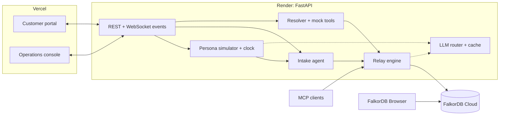

# Relay: master plan

**Track 02: Agent Memory and Coordination** · Graph Hacks (WeMakeDevs × FalkorDB) · solo
**One line:** shared memory for teams of agents. They hand off work, disagree safely, and every answer shows its source path.

This is the only plan document. Older notes are in `_archive/`. The submission README is [`README.md`](README.md) (with the technical detail in `agent-relay/README.md`).

> **Names.** This plan was written when the demo company was *Ping Me Later* and its intake agent *Kavya*. The demo is
> now **WiFight** with **Mr.Fix-It** (see `PROGRESS.md` phases 14 and 16); the product is **Relay** throughout.

---

## 1. What we are building, and where

We build **our own application**. FalkorDB is the database the memory lives in, not where the app runs.

| Piece | What it is | Runs on |
|---|---|---|
| Relay engine | Python: write path, read path, two clocks, conflict ranking, consolidation | inside the API |
| Agents | Intake, resolver, simulated customers, mock tools | inside the API |
| API | FastAPI: REST + WebSocket event stream | **Render** |
| Web app | React + TypeScript: customer portal + operations console | **Vercel** |
| Memory | One graph per tenant | **FalkorDB Cloud** |
| FalkorDB Browser | The same graph and the same Cypher | proof only |
| MCP server | Any AI client joins as another agent | local (stdio) |

## 2. The company: Ping Me Later

**Tagline:** *"We'll fix it before you have to."*
A fictional regional fiber broadband provider in India (name checked: no real ISP uses it).

- **HQ** in Pune, serving about 200K homes in Pune, Mumbai, Bengaluru and Hyderabad.
- **Plans:** Fiber 100 / 300 / 1000. **Routers:** PML Hub 6, Hub 6 Pro. **Add-ons:** static IP, mesh extender.
- **Support:** WhatsApp, email, phone and web chat, staffed by an AI desk (intake + resolver) with human escalation. Ticket IDs look like `PML-2041`.
- **Personality:** calm, plain-spoken, upfront about outages. The tagline is the product story: the resolver spots an outage or a known fix before the customer has to chase it, because the team's memory connects the dots.

**Design: clean and light.** Cool off-white surfaces, ink-navy text and one brand accent (a "signal" teal). Semantic colours stay separate: green for current, amber for conflict, dashed grey for superseded. A deliberate typeface pairing (no Inter, no purple gradients), tabular numbers for times and metrics. A logo mark, real plan names, agent avatars, outage banners and IST timestamps make it feel like a real company.

**Two surfaces:**
1. **Customer portal**: a Ping Me Later support page with chat. You or a judge type as a customer.
2. **Operations console**: Ping Me Later's internal tool for its AI desk. It has live conversations, a live memory graph, a ticket board, an agent activity feed (intake, resolver, tool calls, MCP agents), a time scrubber, node inspector cards, a Cypher drawer and the benchmark page.

## 3. Cast and model routing

Groq free limits on this account: `gpt-oss-120b`, `gpt-oss-20b` and `qwen3.8-27b` each allow 30 requests/min, 1K requests/day, 8K tokens/min and 200K tokens/day. `allam-2-7b` allows 7K requests/day and 500K tokens/day. **No Llama models are available.** Gemini (AI Studio) works.

| Job | Primary | Fallback on 429 |
|---|---|---|
| Fact extraction | `gpt-oss-20b`, strict schema | Gemini Flash-Lite → `qwen3.8-27b` |
| Answers (app + benchmark) | `gpt-oss-120b`, strict schema | `qwen3.8-27b` |
| Intake's conversational replies | Gemini Flash-Lite | `allam-2-7b` |
| Simulated customers | `allam-2-7b` (English quality tested first) | Gemini Flash-Lite |
| Session and community summaries | `allam-2-7b` | Gemini Flash-Lite |
| Embeddings | fastembed `bge-small-en-v1.5`, local, 384-d | Gemini embeddings if Render RAM is tight |

**Rules:**
- Every LLM call is cached on disk.
- Contexts are capped at 30 lines; gpt-oss runs at low reasoning effort, temperature 0.
- Agents' own messages skip extraction.
- One account per provider; no multi-account key rotation.

## 4. Features (priority order)

**P0: built and tested**
- Atomic fact write + supersede in one Cypher statement (0 duplicates with 8 concurrent writers)
- **Predicate normalization at write time:** extraction is constrained to a fixed predicate enum (strict JSON schema), so "moved to / relocated to / based in" all become `lives_in` before anything is stored. Contradiction detection depends on this, and the README says so explicitly
- Two clocks (true in the world / on file), history kept
- Cross-agent disagreement kept and ranked by trust, then recency
- Multi-hop recall, procedural fixes, the path behind every answer, a Cypher log for every action
- Label propagation + PageRank, MCP server, benchmark harness, load tests

**P1: the demo**
1. Per-job LLM routing with fallbacks
2. Conversational intake (replies grounded in memory)
3. Persona simulator: hidden schedules of life events + a simulated clock; the LLM picks the words, the schedule guarantees the moments
4. FastAPI + WebSocket events: `message`, `fact_created`, `fact_corroborated`, `fact_superseded`, `conflict`, `ticket_opened`, `handoff`, `tool_call`, `answer`
5. Web app: portal + console, with the live graph animating as events arrive
6. **Readable node cards** (no LLM), built straight from the graph:
   - Fact: "Alice Rao lives in Pune. Current since 10 Sep, learned by intake in session s2, replaced Mumbai."
   - Episode: the message text, who said it and when
   - Entity: "Alice Rao: 9 current facts, 3 superseded, 1 open ticket, 2 sessions"
   - Ticket: status history + handoff trail

**P2: depth and rigor**

7. LLM summaries stored in the graph: `Session.summary` at session end, `Community.summary` at consolidation (the GraphRAG idea; also readable in FalkorDB Browser)
8. PageRank salience as the "importance" term in ranking (the Generative Agents idea)
9. **Per-tenant predicate registry**: a new domain means a new registry, with the engine unchanged. Needed for the external benchmark (§6)
10. Scaled dataset + the full evaluation in §6

**P3: if time allows**

11. MCP demo beat: Claude joins as a fourth agent (`mcp`), after intake, the resolver and Network Ops (20 s)
12. A second tenant (for example a clinic front desk)

### Add-on: shared knowledge (how the agents share what they know)
Built because the track prize is "the best agents that remember across sessions **and share what they know**":
1. **Company knowledge in the graph**: plans, add-ons, services, policies, coverage areas, routers. Customers link to the plan and area nodes, so "what does my plan include?" is one hop, and Kavya answers company questions from the graph, not from a prompt.
2. **Network topology + a third agent (NOC)**: backbone → POP → OLT → customer. When a node fails, the NOC agent traverses the graph to find every affected customer, writes the outage into shared memory, links tickets, and intake messages them **before they complain**. That is the tagline made real. It uses `algo.betweenness` (critical nodes), shortest paths (why a customer is affected) and WCC (isolated segments).
3. **Sharing made visible and measurable**: `CONSULTED` edges each time an agent uses a fact. A sharing dashboard shows facts written vs consulted per agent, reuse from other agents (%), knowledge flows between agents, and the most-shared facts.
4. **Expertise**: technicians on tickets. "Who has fixed Hub 6 Pro reboots before?" becomes a traversal.

It also answers FalkorDB's own example questions: "What did this customer ask for last month, and was it resolved?" (conversation + ticket history), "Who on the team has worked on this system before?" (expertise) and "What breaks if this service goes down?" (network impact).

## 5. Architecture

## 6. Evaluation

### Dataset
| | Target (today: 8 customers / 114 turns / 74 questions) |
|---|---|
| Customers | ~40 |
| Customer turns | ~500 |
| Questions | ~160, 9 types |
| Noise | small talk, **planted name collisions** ("alice rao" / "alice roy"), several tickets per customer, typos |

Seeded storylines and several phrasing templates. Gold answers come from the storyline, so scoring is exact-match. Fictional company and people only.

### What we report, and how
1. **Headline = aggregate accuracy with a 95% Wilson interval.** Per-type results are shown as directional, with their intervals visible (about ±20 points at 15 questions per type). We don't over-narrate small cells, including the 60-question subset used for the secondary systems.
2. **Gap decomposition by question type.** This shows the vector baseline is competitive on simple recall and collapses only where the graph structurally wins (updates, temporal, disagreement, multi-hop, abstention). It's the answer to "rigged baseline".
3. **Baseline k-sensitivity:** B1 at k = 10, 20 and 50 on the subset, so top-10 isn't a strawman.
4. **Component metrics, measured on their own:**
   - **Entity resolution** precision/recall on the planted name collisions and aliases (same entity merged? different entities kept apart?)
   - **Contradiction handling** accuracy per planted change: correct supersede, and no false supersede on multi-valued facts, unchanged values or cross-agent claims
   - **Predicate normalization:** share of extracted predicates matching the planted predicate
5. **Abstention precision/recall:** on questions that should be refused, did it refuse (recall)? When it refused, should it have (precision)? Hallucinated answers are counted separately.
6. **Determinism:** answers run at temperature 0, and a 40-question subset is re-run 3 times with the cache bypassed to report the variance.
7. **External validity (required, not optional):**
   - **Out-of-distribution extraction:** customer messages for the planted facts are written by a different model (Gemini), not our templates, and extraction recall is measured on them.
   - **LoCoMo:** at least one public conversation, run through Relay (with a general "personal life" predicate registry) and B1, on its own questions. This is our one datapoint not built on our own exam, so it's reported even if noisy.

### Systems
Relay (FULL), B1 (vector: customer-filtered, dated, newest first), B0 (B1 without dates), A1 (no two clocks), A2 (no multi-hop). For each question, every system uses the same answer model and prompt. Questions are split between `gpt-oss-120b` and `qwen3.8-27b` to double throughput, with the per-model breakdown reported.

### Quota
Everything is cached and resumable. Roughly:
- extraction: about 500 synthetic + about 300 LoCoMo turns;
- answers: FULL and B1 on everything, secondaries on the subset, plus the k-sweep, variance re-runs and LoCoMo.

That spreads over several days of free quota. Order of priority: FULL vs B1 → gap decomposition and component metrics (no extra LLM calls) → LoCoMo → k-sweep → variance → ablations.

### Measured so far (small dataset)
- Relay 93% vs vector 43% (91% vs 43% on the same 46 questions).
- Extraction 97% in-distribution; an out-of-distribution number is still to come.
- 18–24 writes/s with 0 duplicates.
- Recall 178 ms at 1.1K facts, 210 ms at 10.9K.

## 7. Research grounding

| Paper | Idea | In Relay |
|---|---|---|
| Zep / Graphiti | Bi-temporal facts, invalidate instead of delete, entity resolution | Yes. We differ: contradictions decided deterministically (predicate enum + cardinality + policy), plus multi-agent trust ranking |
| Mem0 | ADD / UPDATE / NOOP memory operations | Yes: new / supersede / corroborate |
| LongMemEval | Question categories incl. updates, temporal reasoning, abstention | Yes: our question types and abstention P/R |
| Generative Agents | Recency × importance × relevance | Partly → P2 PageRank salience |
| Microsoft GraphRAG | Community summaries | Partly → P2 community summaries |
| HippoRAG | Personalized PageRank retrieval | No (bounded hops); cited |
| MemGPT / Letta | Single-agent context paging | No; cited |
| LoCoMo | Long multi-session benchmark | Yes: external validity check |

## 8. Deployment

**Render (API):**
- A `render.yaml` blueprint for a Python 3.12 web service.
- Build: `pip install -r requirements.txt && python -m relay.warm`, which downloads the embedding model at build time.
- Start: `uvicorn api.main:app --host 0.0.0.0 --port $PORT`; `/health` check.
- Secrets in env vars. CORS allows the Vercel domain only. WebSockets supported.
- **Free plan:**
  - 512 MB RAM: measure, and fall back to Gemini embeddings if it's over about 450 MB.
  - Sleeps when idle: show a "waking up" screen.
  - The disk is wiped on each deploy: a pre-warmed demo cache ships in the repo (responses only, no secrets) for a deterministic replay.

**Vercel (web):**
- `web/` is a Vite + React + TypeScript app.
- `npm run build` → `dist/`, with `vercel.json` rewrites for the single-page app.
- `VITE_API_URL` / `VITE_WS_URL`. No secrets in the frontend.

**FalkorDB Cloud:** public endpoint plus password, reachable from Render.

## 9. Build order

| # | Step | Done when |
|---|---|---|
| 1 | LLM router + fallbacks | Jobs route by config; a 429 falls through |
| 2 | Conversational intake + persona simulator + clock | A 3-customer simulation hits every planted moment |
| 3 | FastAPI + WebSocket events + `render.yaml` | Events stream locally and on Render |
| 4 | Web app: portal + console + live graph + node cards + Cypher drawer | Graph animates during a simulation; live on Vercel |
| 5 | Summaries + salience + per-tenant registry | Summaries visible in cards and in Browser |
| 6 | Scaled dataset + full evaluation (§6) | README tables with intervals, decomposition, component metrics, LoCoMo |
| 7 | MCP beat, second tenant | — |
| 8 | Video, blog post, submission | Submitted |

## 10. Risks

| Risk | Mitigation |
|---|---|
| Daily LLM quotas | Per-job models, Gemini fallback, cache, priority order in §6 |
| `allam-2-7b` English quality | Test first; Gemini Flash-Lite fallback |
| Render free-plan RAM and sleep | Measure; Gemini embeddings; warm-up screen; demo cache; a keep-awake ping every 10 minutes during judging (`.github/workflows/keep-awake.yml`) |
| FalkorDB free-tier memory | One graph per tenant; dataset sized well below the ceiling |
| Self-graded benchmark | Out-of-distribution extraction + LoCoMo + component metrics |
| Live demo flakiness | Deterministic replay for the video; live typing as a bonus; Judge mode answers only what the agents ask; resets need a reset key and writes are rate-limited, so nobody wipes the demo |
| Judges probe the code | All Cypher in one commented file; walk through it before submitting |

## 11. Submission checklist

- [ ] **Public repo.** Still private: judges get a 404 on the code and every README link. The history was scanned (66 commits): no key, password or host was ever committed, only `.env.example` files. GitHub → Settings → General → Danger Zone → Change visibility → Public
- [x] README: the repository [`README.md`](README.md) (problem, live Judge mode, results, Track 2 mapping, "Remove FalkorDB and…" with Cypher, MCP, what's next, AI disclosure) and the technical [`agent-relay/README.md`](agent-relay/README.md) (setup, graph data model, memory types, predicate normalization, key Cypher, concurrency, benchmark, data statement, prior work)
- [ ] Demo video (3 min), recorded from Judge mode, so the video and the live demo tell the same story; plus a 20–30 s clip of Claude Code writing a fact over MCP that Mr.Fix-It then uses
- [x] Live deployment: Vercel (`wifight.vercel.app`) + Render (`relay-api-6twk.onrender.com`) + FalkorDB Cloud (a new instance; demo story loaded)
- [x] Track named: "Track 02, Agent Memory and Coordination"
- [x] AI-assistant use disclosed (both READMEs)
- [ ] Blog post (side prize)
- [ ] After judging: rotate the FalkorDB password, Groq keys, `RELAY_RESET_KEY` and `RELAY_TENANT_SECRET` (all pasted in chat), and disable the keep-awake workflow
