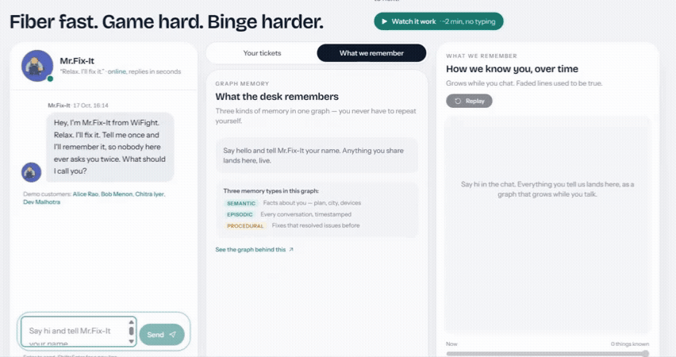
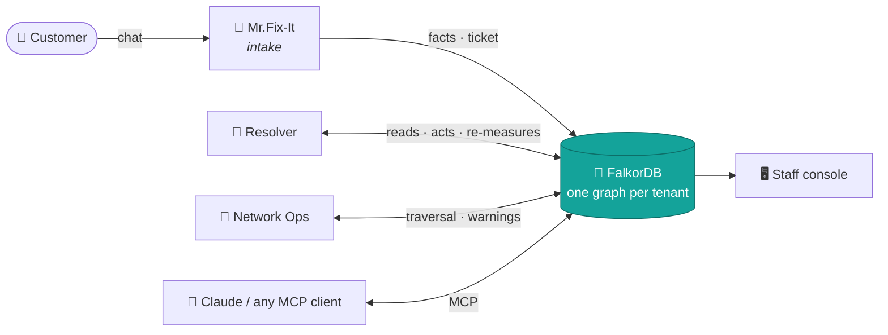
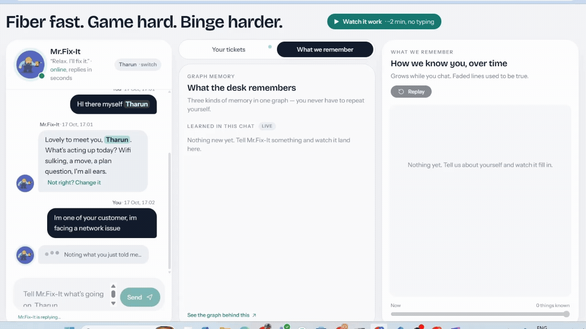
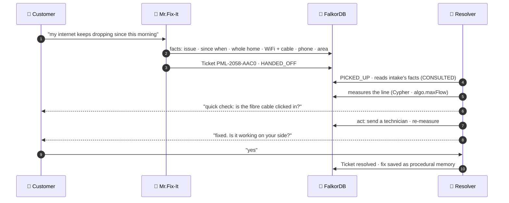
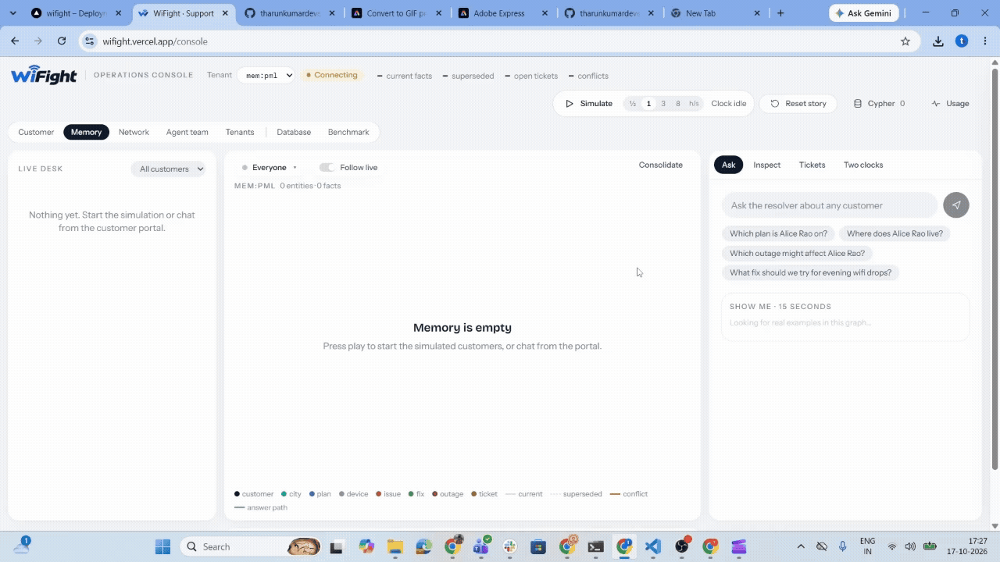
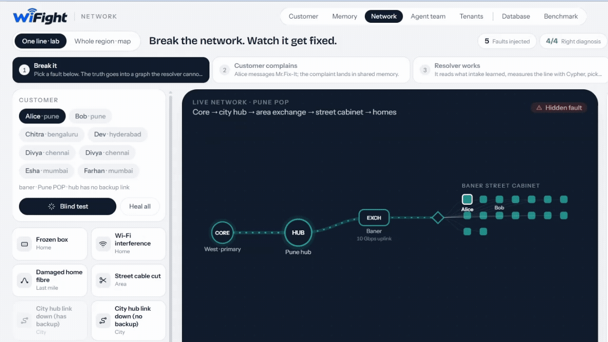
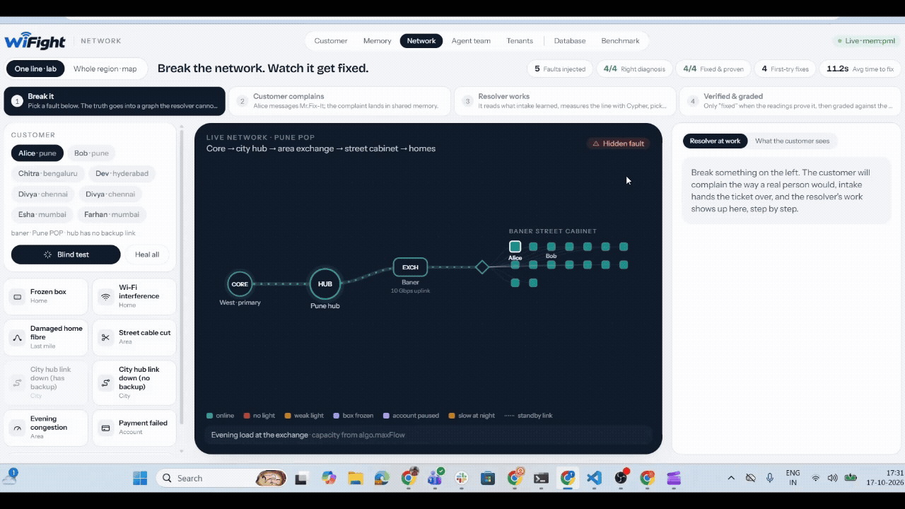
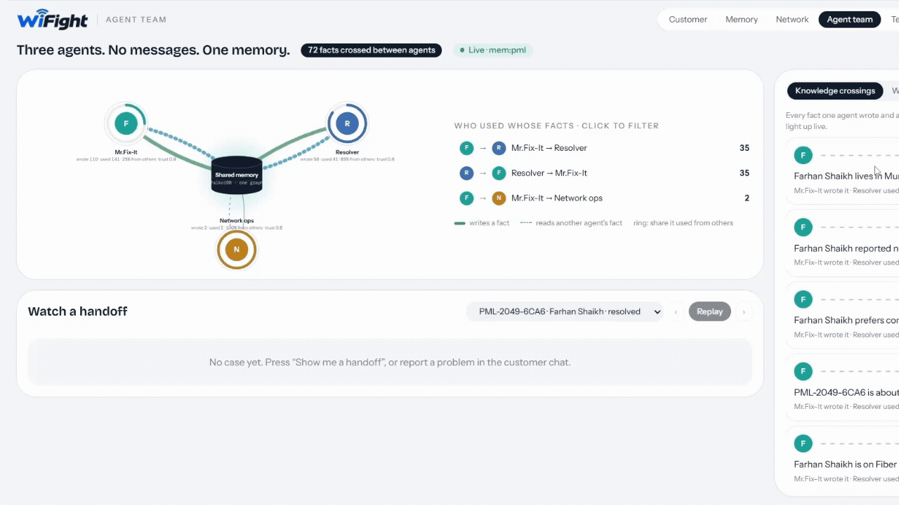
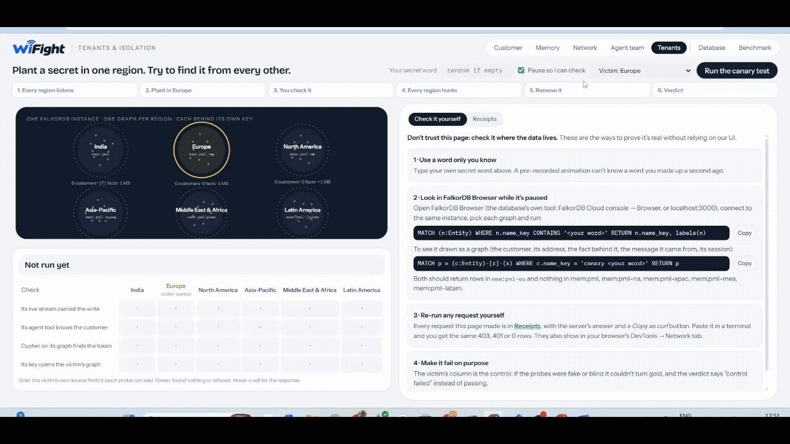
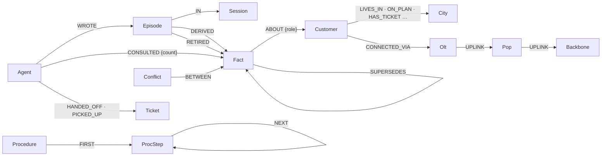

<div align="center">

# 🧠 Relay

### Shared memory for teams of AI agents

**Two agents that never message each other, yet never contradict each other.**

[](https://wifight.vercel.app)
[](#-the-five-memory-capabilities)
[](#-results)

[](https://wifight.vercel.app/?judge=1)
[](https://wifight.vercel.app)
[](https://wifight.vercel.app/console)

<br>



<sub><b>Judge mode</b>: one click plays the whole story through the real agents. Nobody types.</sub>

</div>

<br>

> **Built for Graph Hacks (WeMakeDevs × FalkorDB), Track 02: Agent Memory and Coordination, by team _The Final Boss_.**
> To prove Relay works, we built a whole company on top of it: **WiFight**, a fiber internet provider whose AI support
> desk runs on one shared FalkorDB graph.

**Nothing to install.** Everything runs live: open the site and either **watch** (Judge mode plays the whole story in
about two minutes) or **take part** (chat as yourself, break the network, settle an argument between agents). The only
piece you set up yourself is the optional MCP connection for Claude ([below](#-bring-your-own-agent-mcp)).

<div align="center">

| 🎯 **99.4%** | 🤖 **3 agents** | 🗺️ **6 regional graphs** | ✍️ **0 duplicates** | 🔌 **14 MCP tools** | 🌍 **39 countries** |
|:---:|:---:|:---:|:---:|:---:|:---:|
| accuracy vs 61.2% for a vector store | that never message each other | one FalkorDB graph per tenant | with 8 writers at once | Claude joins as a 4th agent | local plans and prices |

</div>

---

<details>
<summary><b>📑 Contents</b></summary>

- [The idea](#-the-idea)
- [Meet WiFight](#-meet-wifight)
- [Why we chose an ISP](#-why-we-chose-an-isp)
- [How a ticket works](#-how-a-ticket-works)
- [A tour of every screen](#-a-tour-of-every-screen)
- [Watch it, or take part](#-watch-it-or-take-part)
- [The five memory capabilities](#-the-five-memory-capabilities)
- [Results](#-results)
- [Remove FalkorDB and…](#-remove-falkordb-and)
- [Bring your own agent (MCP)](#-bring-your-own-agent-mcp)
- [Tech stack](#-tech-stack)
- [Team](#-team-the-final-boss)
- [Run it yourself](#-run-it-yourself)

</details>

## 💡 The idea

Teams of AI agents usually coordinate by passing messages, and each one keeps its own notes. So they drift: billing
still has the old address, support asks the customer again, and a handoff loses half the context.

**Relay gives every agent one memory instead.** The agents never talk to each other. Everything one learns, the
others find in the graph, with **who** wrote it, **when** it was true, **what** it replaced, and the **path** behind
every answer.



## 🏢 Meet WiFight

<p align="center">
  <picture>
    <source media="(prefers-color-scheme: dark)" srcset="docs/brand/wordmark-dark.png">
    
  </picture>
</p>

<p align="center"><i>"Fiber fast. Game hard. Binge harder."</i></p>

**WiFight** is the fictional internet provider we made for this hackathon, and it behaves like a real one:

- 🌍 **39 countries in 6 regions**: India, Europe, North America, Asia-Pacific, Middle East & Africa, Latin America.
  199 cities and 1,118 areas, with real place names from GeoNames.
- 💸 **Local plans and prices**: Fiber 100, 300 and 1000 and more, in each country's currency and taxes, plus add-ons,
  services and coverage. All of it lives in the graph; nothing is hard-coded in a prompt.
- 🛰️ **A real last-mile network in the graph**: core → city hub → exchange → street cabinet → your home.
- 🤝 **An AI support desk of three agents** that never message each other:

<table>
<tr>
<td width="33%" valign="top" align="center">
<br>
<b>Mr.Fix-It</b> · intake<br>
<sub>Chats with customers, picks up their name, asks only what's missing, writes each detail into the graph, opens
tickets and hands them over</sub>
</td>
<td width="33%" valign="top" align="center">
<h1>🔧</h1>
<b>Resolver</b><br>
<sub>Picks tickets up from the graph, reads what intake learned, measures the line with Cypher, acts, and re-measures
before calling it fixed</sub>
</td>
<td width="33%" valign="top" align="center">
<h1>📡</h1>
<b>Network Ops</b><br>
<sub>Watches the network graph; when a node fails, finds every affected customer by traversal and warns them before
they complain</sub>
</td>
</tr>
</table>

## 🤔 Why we chose an ISP

We wanted a domain where shared memory isn't a nice-to-have but **the whole job**:

| | Why it matters for agent memory |
|:---:|---|
| 🔁 | **Customers hate repeating themselves.** "Tell us once" is the test of a support desk, and it's exactly the test of shared memory |
| 🎫 | **It's naturally multi-agent.** Intake, diagnostics, billing and network operations are different jobs, and work moves between them as **tickets**. Every handoff can lose context |
| 🏠 | **Facts change all the time.** People move, switch plans, get new routers. A memory that only appends text will say you live in two cities at once |
| ⚖️ | **Systems disagree.** Billing says Fiber 100, the customer says Fiber 300. Someone has to keep both claims, rank them, and let a person settle it |
| 🕸️ | **The network itself is a graph.** "Who's affected if this cabinet fails?" is a traversal, not a search, so FalkorDB does real work |

## 🎫 How a ticket works

A complaint goes from a sentence in the chat to a verified fix, and **the two agents never message each other**: the
ticket and the facts in the graph are the only thing they share.

<p align="center"></p>



<div align="center">

`📝 Reported` ──▶ `🔍 Checking your line` ──▶ `🛠️ Fixing` ──▶ `✅ Fixed`

</div>

If every reading is healthy but the customer says it's broken, **the resolver doesn't argue**: the home is marked
*reported faulty* and a technician goes to look.

## 🧭 A tour of every screen

### 🛒 The customer site · [wifight.vercel.app](https://wifight.vercel.app)

| Part | What it is | How to use it |
|---|---|---|
| 💬 **Chat with Mr.Fix-It** | The support chat. No form: it learns your name from what you type | Say hi with your name, then describe a problem in your own words. Replies that rest on what you said before carry a **"How I know"** line |
| 🎫 **Your tickets** | Every ticket you opened, its stage, and the resolver's work step by step | Report a fault and watch it move; a technician visit shows as a live trip |
| 🧠 **What we remember** | Every fact the desk holds about you: who wrote it, when, and what it replaced | Say "I've moved to Pune" and watch the old fact close and the new one appear |
| 🛰️ **Network lab** | Your own line, live: core → hub → exchange → cabinet → your home (neighbours stay anonymous) | Appears once you have a line and a case; faults glow, and a dispatched van drives out |
| ▶️ **Watch it work** | Judge mode: the whole story through the real agents | One click; a caption bar says what to watch at each step |
| 🌍 **Region · Plans · Coverage** | Six regional desks, local prices, which cities are degraded right now | Switch region at the top; everything comes from that region's graph |

### 🖥️ The staff console · [wifight.vercel.app/console](https://wifight.vercel.app/console)

The top bar is shared by every screen: the **menu**, the **simulator** (▶ simulated customers at ½ to 8 simulated hours
per second), the **Cypher drawer** (every query the agents just ran, with FalkorDB's `EXPLAIN` and `PROFILE`), the
**LLM quota** chip, and **reset** (locked on the public demo with a reset key, so nobody can wipe it).

#### 🧠 Memory: the graph, live and through time

<p align="center"></p>

The live memory graph and the agents' feed, plus a **Replay** with a time bar to scrub through history. Side tabs:
**Ask** (a question, answered with the path behind it), **Inspect** (click any node), **Tickets** and **Two clocks**.
**Show me** runs 15-second contrasts on real data, including the agents' disagreement with a **"This one is right"**
button: the conflict closes, and each agent's trust on that kind of fact learns from it.

#### 🛰️ Network: one customer's line, live

<p align="center"></p>

**One line · lab** shows any customer's connection from the core to their street cabinet, with the eight faults you can
inject on the left. **Whole region · map** shows every hub at its real location; for India, on a map of India
(Natural Earth's India point-of-view boundary, which follows India's official map, including all of Jammu & Kashmir
and Ladakh).

#### 💥 Break it: the resolver, graded against the truth

<p align="center"></p>

Pick one of **eight real faults** (a frozen box, Wi-Fi interference, damaged home fibre, a cut street cable, a hub link
down with or without backup, evening congestion, a failed payment), or a **blind random** one. The truth goes into a
graph the resolver can't read. Watch it go **break it → customer complains → resolver works → verified & graded**, and
the scoreboard counts right diagnoses and proven fixes.

#### 🤝 Agent team: knowledge sharing, measured

<p align="center"></p>

The agents around one shared memory: dots fly from the agent that **wrote** a fact to the agent that **used** it.
**Watch a handoff** replays a real case lane by lane, **Knowledge crossings** lists every fact that moved between
agents, and **Who has worked on this?** finds experts by graph.

#### 🔒 Tenants: isolation you can verify yourself

<p align="center"></p>

Six regions, six separate FalkorDB graphs. Type a secret word, write it into one region, and watch every other region
fail to find it: through its live stream, its agent tools and raw Cypher. You can check it yourself outside our UI too.

#### 🗄️ Database and 📊 Benchmark

- **Database**: FalkorDB, live: memory against the free tier, node and edge counts, indexes, `GRAPH.SLOWLOG`, and
  snapshots (one is taken before every reset; restore is one click).
- **Benchmark**: Relay vs a vector store on 160 questions, by question type, plus concurrency. **Ask both memories**
  the same question live and compare the answers and the evidence side by side.

## 🎮 Watch it, or take part

| 👀 Just watch | 🙋 Take part |
|---|---|
| **Judge mode** (▶ Watch it work): a new customer, a fault, a technician, a move, a new session, in about two minutes | **Chat as yourself**: give a name, report a problem in plain words, come back later, and see that nothing is asked twice |
| **The simulator** (console ▶): simulated customers with hidden life events, weeks in minutes | **Move house**: "I no longer live in Chennai, I've moved to Pune" closes the old fact on both clocks |
| **A blind fault** (Network → random): the resolver doesn't know what broke | **Break something specific** and see whether the resolver gets it right |
| **Replay** (Memory): scrub the graph back through time | **Settle a disagreement**: Memory → Show me → "This one is right" |
| **Watch a handoff** (Agent team) | **Run the isolation test** (Tenants) with your own secret word |

## 🧩 The five memory capabilities

<table>
<tr><th width="24%">Capability</th><th>How Relay does it</th><th width="26%">See it · prove it</th></tr>
<tr>
<td><b>📚 Episodic, semantic, and procedural memory</b></td>
<td><b>Episodic</b>: every message, reply and tool reading is an <code>Episode</code> node.<br>
<b>Semantic</b>: what's true is a <code>Fact</code> (subject, predicate, object) with two clocks and an author, mirrored as a typed edge like <code>(:Customer)-[:LIVES_IN]->(:City)</code>.<br>
<b>Procedural</b>: a fix that worked is a path, <code>(:Procedure)-[:FIRST]->(:ProcStep)-[:NEXT]->…</code>, scored by successes and failures, and tried first next time</td>
<td>Memory → Inspect; "procedural memory" in the resolver's steps.<br><b>Procedural questions: 100% vs 50%</b><br><a href="agent-relay/relay/procedural.py"><code>procedural.py</code></a></td>
</tr>
<tr>
<td><b>🕰️ Persistent conversation history</b></td>
<td>Nothing is overwritten. A changed fact <b>supersedes</b> the old one; an ended fact is <b>retired</b>. Every fact keeps <b>two clocks</b>: when it was true in the world (<code>valid_from/valid_to</code>) and when we had it on file (<code>recorded_at/expired_at</code>). Sessions persist across visits</td>
<td>Judge mode step 5; Memory → Two clocks, Replay.<br><b>About −19 points without the two clocks</b><br><a href="agent-relay/relay/queries.py"><code>queries.py</code></a></td>
</tr>
<tr>
<td><b>🤝 Shared state and handoffs between agents</b></td>
<td>The agents never message each other. A ticket's <code>HANDED_OFF</code> / <code>PICKED_UP</code> edges and the facts it points to are the only coordination. Every read records <code>(:Agent)-[:CONSULTED]->(:Fact)</code>. When agents disagree, both claims stay, ranked by trust, with a <code>Conflict</code> node; a person can confirm the right one, and trust learns</td>
<td>Your tickets; Agent team.<br><b>Disagreements: 100% vs 6%</b><br><a href="agent-relay/relay/agents.py"><code>agents.py</code></a> · <a href="agent-relay/relay/sharing.py"><code>sharing.py</code></a></td>
</tr>
<tr>
<td><b>⚡ High-concurrency reads and writes</b></td>
<td>One Cypher statement per fact write: it creates the fact, corroborates a repeat (never a duplicate), or supersedes what it contradicts, atomically. FalkorDB serializes writes per graph, so no reader sees two current values</td>
<td>Benchmark → Concurrency.<br><b>8 writers · 18.3 writes/s · 0 duplicates</b><br><a href="agent-relay/eval/bench.py"><code>bench.py</code></a></td>
</tr>
<tr>
<td><b>🔒 Separate memory per user or tenant</b></td>
<td><b>Per tenant</b>: one FalkorDB graph per region (<code>mem:pml</code>, <code>mem:pml-eu</code>, …); every request needs that tenant's key.<br>
<b>Per user</b>: Mr.Fix-It only ever sees that customer's own facts, tickets and local outages; requests for someone else's data get a fixed refusal</td>
<td>Tenants → canary test.<br><a href="agent-relay/relay/tenancy.py"><code>tenancy.py</code></a> · <a href="agent-relay/tests/test_canary.py"><code>test_canary.py</code></a></td>
</tr>
</table>

<details>
<summary><b>🗺️ The graph data model</b></summary>



</details>

## 📊 Results

**160 questions over 40 customers and 556 conversation turns.** Both systems get the same answer model (qwen3.8-27b)
and the same prompt; only the memory differs. The baseline is a vector store over the same conversations, filtered to
the customer, top 10 chunks, each dated, newest first.

<div align="center">

| | 🧠 Relay | 📦 Vector store |
|---|:---:|:---:|
| **Accuracy** | **99.4%** (159/160) | 61.2% (98/160) |
| Difference | **+38 points** [+31, +46] · McNemar p = 1.4 × 10⁻¹⁷ | |
| Gold fact in the context | 100% | 72% |
| Should-refuse questions: precision / recall | 100% / 94% | 50% / 78% |

</div>

| Question type | 🧠 Relay | 📦 Vector store |
|---|---|---|
| ⚖️ Two agents disagree | `████████████████████` 100% | `█` 6% |
| 🕸️ Multi-hop (customer → city ← outage) | `████████████████████` 100% | `████` 22% |
| 📋 Completeness (every device, every ticket) | `████████████████████` 100% | `█████████` 44% |
| 🛠️ Procedural (what fixed this before?) | `████████████████████` 100% | `██████████` 50% |
| 🔄 Current truth after changes | `████████████████████` 100% | `██████████████` 72% |
| 🤝 Handoff (what did the other agent learn?) | `████████████████████` 100% | `█████████████████` 83% |

- **Ablations** (an earlier run on a 63-question subset, one model for every arm): without the two clocks about
  **−19 points**, without multi-hop expansion about **−9**.
- **What it doesn't prove:** the benchmark data is synthetic, built from our own templates. On the one external check
  ([LoCoMo](https://github.com/snap-research/locomo), open-ended personal chat), **Relay loses on token F1 (0.08 vs
  0.27)** because it keeps facts, not transcripts. It did refuse 15/15 false-premise questions, against 4/15.

Full tables and how every number was produced: [`PROGRESS.md` §6](PROGRESS.md#6-results) ·
[`eval/results.md`](agent-relay/eval/results.md).

## 🔬 Remove FalkorDB and…

Swap the graph for a vector store and these stop working:

| | |
|---|---|
| 🕰️ **Two clocks** | "Where did she live on the 5th?" and "What did we have on file then?" diverge when someone tells us late |
| 🚫 **Retire** | "I no longer live there" must stop matching; in a vector store the old chunk keeps ranking |
| ⚖️ **Conflict ranking** | Both claims kept and ranked by trust, then recency, instead of last-write-wins |
| 🧭 **Answer paths** | Every answer comes with the hops that found it, not a list of similar chunks |
| 💥 **Blast radius** | "Who's affected if this fails" is a bounded traversal plus `algo.maxFlow` |
| 🔒 **Tenant isolation** | One graph per tenant: a query can't reach another tenant's memory |

<details>
<summary><b>The Cypher that does it</b> (from <a href="agent-relay/relay/queries.py"><code>relay/queries.py</code></a>, shortened)</summary>

```cypher
// Write a fact: a repeat corroborates, a contradiction supersedes, all in one statement
MERGE (f:Fact {triple_key:$tk, active:true})
  ON CREATE SET f.fact_id=$fid, f.predicate=$p, f.valid_from=$vf, f.recorded_at=$at, f.asserted_by=$agent
WITH f, s
OPTIONAL MATCH (old:Fact {predicate:$p, active:true})-[:ABOUT {role:'subject'}]->(s)
WHERE $single AND old.fact_id <> f.fact_id AND ($any_agent OR old.asserted_by = $agent)  // other agents' claims are kept
WITH f, collect(old) AS olds
FOREACH (o IN olds | SET o.active=false, o.valid_to=f.valid_from, o.expired_at=$at   // world clock, system clock
                     CREATE (f)-[:SUPERSEDES]->(o))
```

```cypher
// A fact ends with no replacement: both clocks close, the live edge becomes a WAS edge
MATCH (ep:Episode {episode_id:$eid})
MATCH (f:Fact {predicate:$p, active:true})-[:ABOUT {role:'subject'}]->(s:Entity {name_key:$s})
SET f.active=false, f.valid_to=$vt, f.expired_at=$at, f.retired_by=$eid
REMOVE f:Current SET f:Retired
CREATE (ep)-[:RETIRED]->(f)
```

```cypher
// What was true in the world at $t (swap valid_* for recorded_at/expired_at: what we had on file at $t)
MATCH (f:Fact)-[:ABOUT {role:'subject'}]->(:Entity {name_key:$s})
WHERE f.valid_from <= $t AND (f.valid_to IS NULL OR f.valid_to > $t)
MATCH (f)<-[:DERIVED]-(:Episode)<-[:WROTE]-(a:Agent)
RETURN f.predicate, f.object_value, f.valid_from, f.valid_to, collect(DISTINCT a.agent_id)
```

</details>

> **Where the LLM is, and where it isn't.** Extraction is the LLM's job: a strict JSON schema whose predicate field is
> an enum, so "moved to" and "relocated to" both arrive as `lives_in`. **Everything after it (supersede, retire,
> conflicts, recall paths) is pure Cypher**, and the model never writes Cypher: questions go through a fixed catalogue
> of typed tools.

## 🔌 Bring your own agent (MCP)

> **This is the only part you set up yourself.** Everything else runs live on the site.

[`agent-relay/mcp_server.py`](agent-relay/mcp_server.py) lets **Claude Code, Claude Desktop or any MCP client** join
the desk as a fourth agent (`mcp`), on the same graph the live site uses:

```bash
cd agent-relay && pip install -r requirements.txt     # plus a .env with the FalkorDB credentials
claude mcp add relay-memory -- python /path/to/agent-relay/mcp_server.py
```

Then ask Claude: *"Use relay-memory's remember_fact, as agent mcp in tenant pml: subject alice rao, predicate
has_router, object pml hub 6 pro"*, chat as Alice on the site, and ask Mr.Fix-It which router you have. The Agent team
page draws the new agent.

<sub>14 tools: <code>remember</code> · <code>remember_fact</code> · <code>recall</code> · <code>ask</code> ·
<code>explain</code> · <code>tickets</code> · <code>handoff</code> · <code>recall_customer</code> · <code>facts_at</code> ·
<code>claims</code> · <code>who_handled</code> · <code>affected_by</code> · <code>capacity</code> ·
<code>past_fixes</code>. On Windows, the local embedding model needs the current Microsoft Visual C++ runtime.</sub>

## 🛠️ Tech stack

<table>
<tr>
<th>🧠 Memory</th><th>⚙️ Backend</th><th>🎨 Frontend</th><th>🤖 AI</th><th>☁️ Hosting</th>
</tr>
<tr>
<td valign="top">
 <b>FalkorDB</b> (Cloud)<br>
<sub>graph · Cypher · vector index · <code>algo.*</code></sub>
</td>
<td valign="top">
 Python 3.12<br>
 FastAPI · WebSockets<br>
 Pydantic<br>
<sub>Uvicorn</sub>
</td>
<td valign="top">
 React 18<br>
 TypeScript<br>
 Vite<br>
 Tailwind CSS<br>
 Framer Motion<br>
 React Router
</td>
<td valign="top">
 Groq (gpt-oss, qwen)<br>
 Gemini (fallback)<br>
 fastembed (local)<br>
 ONNX Runtime<br>
 MCP<br>
 Claude (MCP client)
</td>
<td valign="top">
 Vercel (web)<br>
 Render (API)<br>
 GitHub Actions
</td>
</tr>
</table>

## 👥 Team: The Final Boss

<div align="center">

| 🧑‍💻 **Tharun Kumar C** | 👩‍💻 **Dharani K** | 👩‍💻 **Thanushrie Satiskumar** |
|:---:|:---:|:---:|

</div>

## 🚀 Run it yourself

Setup, tests and the free deploy (Render + Vercel + FalkorDB Cloud) are in
[`agent-relay/README.md`](agent-relay/README.md#setup), with the full graph model, every key query and a FalkorDB
Browser tour. The API reference is [`agent-relay/api/CONTRACT.md`](agent-relay/api/CONTRACT.md); what we built, in
order, with every measurement and fix, is [`PROGRESS.md`](PROGRESS.md).

On the public demo, resets need a reset key and writes are rate-limited per visitor, so nobody can wipe it during
judging; a scheduled ping keeps the free API awake.

<details>
<summary><b>🏷️ Names, once</b></summary>

| Name | What it is |
|---|---|
| **Relay** | The product: the memory layer (`agent-relay/`) |
| **WiFight** | The fictional ISP running on Relay (brand in [`agent-relay/brand.json`](agent-relay/brand.json)) |
| **Mr.Fix-It** | WiFight's intake agent, the one you chat with |
| `pml`, `PML-…` | Ids left from our first prototype's name: tenant graphs are `mem:pml`, `mem:pml-eu`, …; tickets look like `PML-2058-AAC0` |

</details>

<details>
<summary><b>🔭 What's next</b></summary>

- **Open-domain recall:** when no fact answers, search the customer's conversation text and label the answer "from the
  conversation, not a confirmed fact" (the LoCoMo loss above).
- **Ablations on the final code**, and determinism re-runs.
- **Learned trust everywhere:** answers, not only the claims tool, should rank by it; customers should confirm from the chat.
- Fewer round trips per chat turn, and a retention policy for old episodes.

</details>

<details>
<summary><b>🤖 AI-use disclosure</b></summary>

Built with AI coding assistance (Claude Code) for code generation, review and documentation drafts. The design, graph
model, queries and evaluation were directed, verified and tested by us, and we can explain every component. Runtime
models: Groq `gpt-oss-120b` for extraction, answers and replies, with `gpt-oss-20b` and `qwen3.8-27b` as fallbacks (qwen
is also the benchmark's answer model), Gemini Flash-Lite last; `allam-2-7b` for simulated customers and summaries;
embeddings by fastembed `bge-small-en-v1.5`, run locally. All customer data is synthetic; place names come from
GeoNames (CC BY 4.0); the India outline is Natural Earth's 1:10m boundary from the India point of view (public domain).

</details>

<div align="center">
<br>

**Tell us once. Every agent remembers.**

<sub>Made with 🧠 by <b>The Final Boss</b> for Graph Hacks 2026</sub>

</div>
