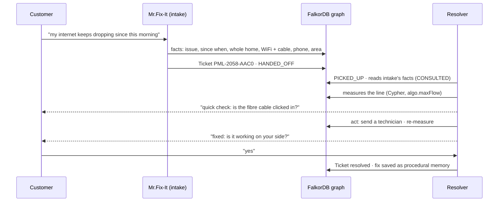

# Relay: shared memory for teams of agents

**Two agents that never message each other, yet never contradict each other.**

We built Relay for **Graph Hacks** (WeMakeDevs × FalkorDB), **Track 02: Agent Memory and Coordination**. To prove it
works, we built a whole company on top of it: **WiFight**, a fiber internet provider whose AI support desk runs on one
shared FalkorDB graph.

<!-- GIF 01 · hero · docs/gifs/01-judge-mode.gif (see docs/gifs/SHOTLIST.md) -->
<p align="center"></p>

### ▶ [Try it live: Judge mode](https://wifight.vercel.app/?judge=1) · [The site](https://wifight.vercel.app) · [Staff console](https://wifight.vercel.app/console) · [Benchmark](https://wifight.vercel.app/console/benchmark)

**Nothing to install.** Everything runs live: open the link and either *watch* (Judge mode plays the whole story in
about two minutes, nobody typing) or *take part* (chat as yourself, break the network, settle an argument between
agents). The only piece you set up yourself is the optional MCP connection for Claude Code ([below](#bring-your-own-agent-mcp)).

<!-- DEMO VIDEO: link here (YouTube / Loom) -->

---

## Contents

[Meet WiFight](#meet-wifight) · [Why an ISP](#why-we-chose-an-isp) · [How a ticket works](#how-a-ticket-works) ·
[Tour of every screen](#a-tour-of-every-screen) · [Watch or take part](#watch-it-or-take-part) ·
[The five memory capabilities](#the-five-memory-capabilities-track-2) · [Results](#results) ·
[Remove FalkorDB and…](#remove-falkordb-and) · [MCP](#bring-your-own-agent-mcp) · [Run it](#run-it-yourself)

## Meet WiFight

> *"Fiber fast. Game hard. Binge harder."*

**WiFight** is the fictional internet provider we made for this hackathon. It looks and behaves like a real one:

- **39 countries in 6 regions** (India, Europe, North America, Asia-Pacific, Middle East & Africa, Latin America),
  199 cities and 1,118 areas, with real place names from GeoNames.
- **Local plans and prices**: Fiber 100, 300 and 1000 and more, priced in each country's currency with its taxes,
  plus add-ons, services and coverage, all stored in the graph (nothing hard-coded in prompts).
- **A real last-mile network** modelled in the graph: core → city hub → exchange → street cabinet → your home.
- **An AI support desk of three agents** that never message each other:

| Agent | What it does |
|---|---|
| **Mr.Fix-It** (intake) | Chats with customers, picks up their name, asks only what's missing, writes each detail into the graph, opens tickets and hands them over |
| **Resolver** | Picks tickets up from the graph, reads what intake learned, measures the customer's line with Cypher, acts (restart, reroute, send a technician), re-measures, and only then calls it fixed |
| **Network ops** | Watches the network graph; when a node fails it finds every affected customer by traversal and warns them before they complain |

<!-- GIF 02 · docs/gifs/02-wifight-home.gif -->
<!-- pending: <p align="center"></p> -->

## Why we chose an ISP

We wanted a domain where shared memory isn't a nice-to-have but the whole job:

- **Customers hate repeating themselves.** Everyone has been asked for their account number three times on one call.
  The test of a support desk is "tell us once": that is exactly the test of shared memory.
- **It's naturally multi-agent.** Intake, diagnostics, billing and network operations are different jobs with
  different tools, and work moves between them as **tickets**. Every handoff is a chance to lose context.
- **Facts change all the time.** People move, switch plans, get new routers. A memory that only appends text will
  happily say you live in two cities at once.
- **Systems disagree.** The billing system says Fiber 100, the customer says Fiber 300. Someone has to keep both
  claims, rank them, and let a person settle it.
- **The network itself is a graph.** "Who's affected if this street cabinet fails?" is a traversal, not a search.
  That makes FalkorDB do real work, not just store rows.

## How a ticket works

A complaint goes from a sentence in the chat to a verified fix without either agent ever messaging the other. The
**ticket and the facts in the graph are the only thing they share.**



On the site you follow it in **Your tickets**: *Reported → Checking your line → Fixing → Fixed*, with the resolver's
steps underneath and the technician's van on the map. If every reading is healthy but the customer says it's broken,
the resolver doesn't argue: the home is marked **reported faulty** and a technician goes to look.

<!-- GIF 03 · docs/gifs/03-ticket-lifecycle.gif -->
<p align="center"></p>

## A tour of every screen

### The customer site · [wifight.vercel.app](https://wifight.vercel.app)

| Part | What it is | How to use it |
|---|---|---|
| **Chat with Mr.Fix-It** | The support chat. No form: it learns your name from what you type | Say hi with your name, then describe a problem in your own words. Replies that rest on what you told us earlier carry a "How I know" line |
| **Your tickets** | Every ticket you opened, its stage, and the resolver's work step by step | Report a fault in the chat and watch it move; a technician visit shows as a live trip |
| **What we remember** | Every fact the desk holds about you: who wrote it, when, and what it replaced | Tell it something ("I've moved to Pune") and watch the old fact close and the new one appear |
| **Network lab** (third card) | Your own line, live: core → hub → exchange → cabinet → your home; neighbours stay anonymous | Appears once you have a line and a case. Faults glow; a dispatched van drives to the fault |
| **▶ Watch it work** | Judge mode: the whole story played through the real agents | One click; a caption bar says what to watch at each step |
| **Region · country · Plans · Coverage** | Six regional desks, local prices, which cities are degraded right now | Switch region at the top; prices and coverage come from that region's graph |

<!-- GIF 04 · docs/gifs/04-network-lab.gif -->
<!-- pending: <p align="center"></p> -->

### The staff console · [wifight.vercel.app/console](https://wifight.vercel.app/console)

The top bar is shared by every console screen: the **menu**, the **simulator** (▶ play simulated customers at ½ to 8
simulated hours per second), the **Cypher** drawer (every query the agents just ran, grouped, with FalkorDB's
`EXPLAIN`/`PROFILE`), the **LLM quota** chip, and **reset** (locked on the public demo with a reset key, so nobody
can wipe it).

| Menu | What it shows | How to use it |
|---|---|---|
| **Customer** | Back to the customer site | Chat as a customer while the console shows the graph react |
| **Memory** | The live memory graph, the agents' feed, and a **replay** with a time bar | Press ▶ or chat; switch to **Replay** and scrub through history. Side tabs: **Ask** (a question, answered with the path behind it), **Inspect** (click any node), **Tickets**, **Two clocks**. **Show me** runs 15-second contrasts on real data, including the agents' disagreement with a **"This one is right"** button |
| **Network** | **One line · lab**: break a real fault and watch the resolver find and fix it, graded against a hidden truth. **Whole region · map**: every hub at its real location | Pick one of eight faults (frozen box, Wi-Fi interference, damaged home fibre, street cable cut, hub link down with or without backup, evening congestion, payment failed), or a blind random one. The scoreboard counts right diagnoses and proven fixes |
| **Agent team** | The three agents around one shared memory: who wrote and who used which facts, live | Watch dots fly from writer to reader; **Watch a handoff** replays a real case lane by lane; **Who has worked on this?** finds experts by graph |
| **Tenants** | The six region graphs and an isolation test you can verify yourself | Type a secret word, write it into one region, and watch every other region fail to find it: their streams, their agent tools and raw Cypher |
| **Database** | FalkorDB, live: memory against the free tier, node and edge counts, indexes, snapshots, slowest queries | Restore a snapshot (taken before every reset), or read `GRAPH.SLOWLOG` |
| **Benchmark** | Relay vs a vector store on 160 questions, by question type, plus concurrency | **Ask both memories** the same question live and compare the answers and evidence |

<!-- GIF 05 · docs/gifs/05-console-memory.gif -->
<!-- pending: <p align="center"></p> -->

<!-- GIF 06 · docs/gifs/06-network-break-it.gif -->
<!-- pending: <p align="center"></p> -->

<!-- GIF 07 · docs/gifs/07-agent-team.gif -->
<!-- pending: <p align="center"></p> -->

<!-- GIF 08 · docs/gifs/08-tenants-canary.gif -->
<!-- pending: <p align="center"></p> -->

## Watch it, or take part

| Just watch | Take part |
|---|---|
| **Judge mode** (▶ Watch it work): a new customer, a fault, a technician, a move, a new session, in about two minutes | **Chat as yourself**: give a name, report a problem in plain words, then come back later and see that nothing is asked twice |
| **The simulator** (console → ▶): simulated customers with hidden life events (a backdated move, a plan dispute, evening Wi-Fi drops, an outage), weeks in minutes | **Move house**: "I no longer live in Chennai, I've moved to Pune" closes the old fact on both clocks |
| **A blind fault** (console → Network → random): the resolver doesn't know what broke; watch it diagnose, then see the grade | **Break something specific** in the Network lab and see if the resolver gets it right |
| **Replay** (console → Memory): scrub the graph back through time | **Settle a disagreement**: Memory → Show me → "This one is right", and watch trust learn from it |
| **Watch a handoff** (console → Agent team) | **Run the isolation test** (console → Tenants) with your own secret word |

## The five memory capabilities (Track 2)

### 1. Episodic, semantic, and procedural memory

- **Episodic:** every message, reply and tool reading is an `Episode` node, linked to its session and the agent that
  wrote it.
- **Semantic:** what's true is a `Fact` node (subject, predicate, object) with two clocks and an author, mirrored as a
  typed edge like `(:Customer)-[:LIVES_IN]->(:City)` so the graph reads like the domain.
- **Procedural:** a fix that worked is stored as a path, `(:Procedure)-[:FIRST]->(:ProcStep)-[:NEXT]->…`, scored by
  successes and failures; the resolver tries the best one first next time.
- **See it:** console → Memory → Inspect any node; the resolver's steps in Your tickets say "procedural memory" when a
  past fix is reused. **Proof:** procedural questions 100% vs 50% for a vector store
  ([`relay/procedural.py`](agent-relay/relay/procedural.py), [`relay/memory.py`](agent-relay/relay/memory.py)).

### 2. Persistent conversation history

- Nothing is overwritten. A changed fact **supersedes** the old one (`SUPERSEDES`), an ended fact is **retired**, and
  both keep **two clocks**: when it was true in the world (`valid_from/valid_to`) and when we had it on file
  (`recorded_at/expired_at`).
- Sessions persist across visits: come back days later and Mr.Fix-It greets you with what happened last time.
- **See it:** Judge mode step 5 (a brand-new session answers from memory); console → Memory → **Two clocks** and
  **Replay**. **Proof:** removing the two clocks costs about 19 points on the benchmark
  ([`RETIRE`, `WRITE_FACT` in `relay/queries.py`](agent-relay/relay/queries.py)).

### 3. Shared state and handoffs between agents

- The agents never message each other. A ticket with `HANDED_OFF` / `PICKED_UP` edges, and the facts it points to,
  are the only coordination.
- Every time an agent reads a fact it records `(:Agent)-[:CONSULTED {count}]->(:Fact)`, so knowledge flow between
  agents is measured, not assumed.
- When agents disagree, both claims stay, ranked by trust then recency, with a `Conflict` node; a person can confirm
  the right one, and each agent's trust on that kind of fact learns from it.
- **See it:** Your tickets during Judge mode; console → **Agent team**. **Proof:** handoff questions 100%, agent
  disagreements 100% vs 6% for a vector store ([`relay/agents.py`](agent-relay/relay/agents.py),
  [`relay/sharing.py`](agent-relay/relay/sharing.py)).

### 4. High-concurrency reads and writes

- One Cypher statement per fact write creates it, corroborates a repeat (never a duplicate), or supersedes what it
  contradicts, atomically. FalkorDB serializes writes per graph, so no reader ever sees two current values.
- **See it:** console → Benchmark → *Concurrency and scale*. **Proof:** 8 writer threads, 18.3 writes/s on one graph
  (23.7 across four), **0 duplicates**, recalls during the writes at p50 310 ms ([`eval/bench.py`](agent-relay/eval/bench.py)).

### 5. Separate memory per user or tenant

- **Per tenant:** one FalkorDB graph per region (`mem:pml`, `mem:pml-eu`, …); every request needs that tenant's key, so
  one region's memory can't be reached from another.
- **Per user:** Mr.Fix-It's replies only ever see that customer's own facts, tickets and the outages in their area,
  never another customer's memory; requests for someone else's data get a fixed refusal.
- **See it:** console → **Tenants** (run the canary test yourself). **Proof:**
  [`relay/tenancy.py`](agent-relay/relay/tenancy.py), [`tests/test_canary.py`](agent-relay/tests/test_canary.py),
  [`tests/test_anomaly.py`](agent-relay/tests/test_anomaly.py).

## Results

**160 questions over 40 customers and 556 conversation turns.** Both systems get the same answer model (qwen3.8-27b)
and the same prompt; only the memory differs. The baseline is a vector store over the same conversations, filtered to
the customer, top 10 chunks, each dated, newest first.

| | Relay | Vector store |
|---|---|---|
| **Accuracy** | **99.4%** (159/160) | 61.2% (98/160) |
| Difference | **+38 points** [+31, +46], exact McNemar p = 1.4 × 10⁻¹⁷ | |
| Gold fact in the context | 100% | 72% |
| Should-refuse questions: precision / recall | 100% / 94% | 50% / 78% |

| Question type | Relay | Vector store |
|---|---|---|
| Two agents disagree | 100% | 6% |
| Multi-hop (customer → city ← outage) | 100% | 22% |
| Completeness (every device, every ticket) | 100% | 44% |
| Procedural (what fixed this before?) | 100% | 50% |
| Current truth after changes | 100% | 72% |
| Handoff (what did the other agent learn?) | 100% | 83% |

- **Ablations** (an earlier run on a 63-question subset, one model for every arm): without the two clocks about
  **−19 points**, without multi-hop expansion about **−9**.
- **What it doesn't prove:** the benchmark data is synthetic, built from our own templates. On the one external check
  ([LoCoMo](https://github.com/snap-research/locomo), open-ended personal chat) **Relay loses on token F1 (0.08 vs
  0.27)**: it keeps facts, not transcripts. It did refuse 15/15 false-premise questions, against 4/15.

Full tables and how every number was produced: [`PROGRESS.md` §6](PROGRESS.md#6-results),
[`agent-relay/eval/results.md`](agent-relay/eval/results.md).

## Remove FalkorDB and…

Swap the graph for a vector store and these stop working: **two clocks** (true then vs on file then), **retire** ("I no
longer live there" must stop matching), **conflict ranking** (both claims kept and ranked, not last-write-wins),
**answer paths** (the hops behind every answer), **blast radius** ("who's affected if this fails" is a traversal plus
`algo.maxFlow`), and **tenant isolation** (one graph per tenant). The core, from
[`relay/queries.py`](agent-relay/relay/queries.py) (shortened):

```cypher
// Write a fact: a repeat corroborates, a contradiction supersedes, all in one statement
MERGE (f:Fact {triple_key:$tk, active:true})
  ON CREATE SET f.fact_id=$fid, f.predicate=$p, f.valid_from=$vf, f.recorded_at=$at, f.asserted_by=$agent
WITH f, s
OPTIONAL MATCH (old:Fact {predicate:$p, active:true})-[:ABOUT {role:'subject'}]->(s)
WHERE $single AND old.fact_id <> f.fact_id AND ($any_agent OR old.asserted_by = $agent)  // other agents' claims are kept
WITH f, collect(old) AS olds
FOREACH (o IN olds | SET o.active=false, o.valid_to=f.valid_from, o.expired_at=$at   // world clock, system clock
                     CREATE (f)-[:SUPERSEDES]->(o))
```

```cypher
// What was true in the world at $t (swap valid_* for recorded_at/expired_at: what we had on file at $t)
MATCH (f:Fact)-[:ABOUT {role:'subject'}]->(:Entity {name_key:$s})
WHERE f.valid_from <= $t AND (f.valid_to IS NULL OR f.valid_to > $t)
MATCH (f)<-[:DERIVED]-(:Episode)<-[:WROTE]-(a:Agent)
RETURN f.predicate, f.object_value, f.valid_from, f.valid_to, collect(DISTINCT a.agent_id)
```

**Where the LLM is, and where it isn't:** extraction is the LLM's job (a strict JSON schema whose predicate field is an
enum, so "moved to" and "relocated to" both arrive as `lives_in`). Everything after it (supersede, retire, conflicts,
recall paths) is pure Cypher, and the model never writes Cypher: questions go through a fixed catalogue of typed tools.

## Bring your own agent (MCP)

**This is the only part you set up yourself.** Everything else runs live. [`agent-relay/mcp_server.py`](agent-relay/mcp_server.py)
lets Claude Code, Claude Desktop or any MCP client join the desk as a fourth agent (`mcp`), on the same graph:

```bash
cd agent-relay && pip install -r requirements.txt     # plus a .env with the FalkorDB credentials
claude mcp add relay-memory -- python /path/to/agent-relay/mcp_server.py
```

Then ask Claude: *"Use relay-memory's remember_fact, as agent mcp in tenant pml: subject alice rao, predicate
has_router, object pml hub 6 pro"*, chat as Alice on the site, and ask Mr.Fix-It which router you have. The Agent team
page draws the new agent. Tools: `remember`, `remember_fact`, `recall`, `ask`, `explain`, `tickets`, `handoff`,
`recall_customer`, `facts_at`, `claims`, `who_handled`, `affected_by`, `capacity`, `past_fixes`. On Windows, the local
embedding model needs the current Microsoft Visual C++ runtime.

<!-- GIF 09 · docs/gifs/09-mcp-claude.gif -->
<!-- pending: <p align="center"></p> -->

## Names, once

| Name | What it is |
|---|---|
| **Relay** | The product: the memory layer (`agent-relay/`) |
| **WiFight** | The fictional ISP running on Relay (brand in [`agent-relay/brand.json`](agent-relay/brand.json)) |
| **Mr.Fix-It** | WiFight's intake agent, the one you chat with |
| `pml`, `PML-…` | Ids left from our first prototype's name: tenant graphs are `mem:pml`, `mem:pml-eu`, …; tickets look like `PML-2058-AAC0` |

## Run it yourself

Setup, tests and the free deploy (Render + Vercel + FalkorDB Cloud) are in
[`agent-relay/README.md`](agent-relay/README.md#setup), with the full graph model, every key query and a FalkorDB
Browser tour. The API reference is [`agent-relay/api/CONTRACT.md`](agent-relay/api/CONTRACT.md); what we built, in
order, with every measurement and fix, is [`PROGRESS.md`](PROGRESS.md).

On the public demo, resets need a reset key and writes are rate-limited per visitor, so nobody can wipe it during
judging; a scheduled ping keeps the free API awake.

## What's next

- **Open-domain recall:** when no fact answers, search the customer's conversation text and label the answer "from the
  conversation, not a confirmed fact" (the LoCoMo loss above).
- **Ablations on the final code**, and determinism re-runs.
- **Learned trust everywhere:** answers, not only the claims tool, should rank by it; customers should be able to
  confirm from the chat.
- Fewer round trips per chat turn, and a retention policy for old episodes.

## AI-use disclosure

Built with AI coding assistance (Claude Code) for code generation, review and documentation drafts. The design, graph
model, queries and evaluation were directed, verified and tested by us, and we can explain every component. Runtime
models: Groq `gpt-oss-120b` for extraction, answers and replies, with `gpt-oss-20b` and `qwen3.8-27b` as fallbacks
(qwen is also the benchmark's answer model), Gemini Flash-Lite last; `allam-2-7b` for simulated customers and
summaries; embeddings by fastembed `bge-small-en-v1.5`, run locally. All customer data is synthetic; place names come
from GeoNames (CC BY 4.0).
