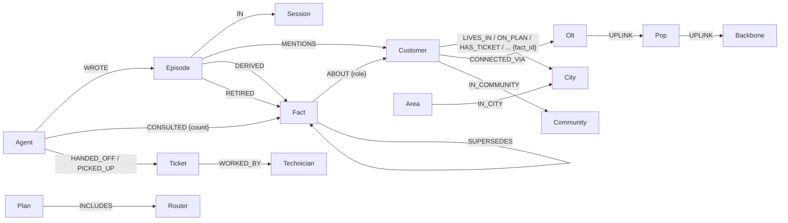

# Relay — shared memory for teams of agents

**Track 02 — Agent Memory and Coordination** · Graph Hacks (WeMakeDevs × FalkorDB)

> Agents hand off work, disagree safely, warn customers before they notice, and every answer shows its source path.

Relay is a memory layer on **FalkorDB** that several agents read and write at once. It remembers across sessions, tracks how facts change on two clocks, keeps disagreements between agents instead of overwriting them, records which agent used which agent's knowledge, and returns the graph path behind every answer.

The demo is **WiFight** (*"Fiber fast. Game hard. Binge harder."*), a fictional fiber broadband provider in 39 countries across six regions (India, Europe, North America, Asia-Pacific, Middle East & Africa, Latin America), with local plans, prices, taxes and coverage. WiFight is one tenant of Relay, not the product. Its AI support desk has three agents that never message each other. Everything one knows, the others find in the graph:

| Agent | Does | Trust |
|---|---|---|
| **Mr.Fix-It (intake)** | Talks to customers, writes what they say into memory, opens tickets and hands them off | 0.9 |
| **Resolver** | Picks up tickets, runs billing / outage / diagnostic tools, tries fixes, assigns field technicians | 0.6 |
| **Network ops (NOC)** | Watches the network graph; when a node fails it finds every affected customer by traversal and warns them first | 0.8 |

A **persona simulator** plays customers on a simulated clock (weeks in minutes). Each persona has a hidden schedule of life events (a backdated move, a plan dispute, evening wifi drops, an outage), so every key moment happens while the LLM chooses the words. You can also chat as a customer yourself in the portal.

**Live:** [wifight.vercel.app](https://wifight.vercel.app) · **[▶ Judge mode](https://wifight.vercel.app/?judge=1)** plays the whole story through the real agents in about two minutes, nobody typing.

*Names:* **Relay** is the memory layer (this folder). **WiFight** is the demo company and **Mr.Fix-It** its intake agent (both set in [`brand.json`](brand.json)). The `pml` prefix on tenant graphs (`mem:pml`, `mem:pml-eu`, …) and ticket ids (`PML-2057-EB25`) is left from the first prototype's name. Code names from earlier brands remain in a few internal identifiers (`Kavya.tsx` draws Mr.Fix-It's avatar).

<!-- DEMO VIDEO -->

Pitch, results and the Track 2 mapping: the [repository README](../README.md).

---

## Why a graph (the swap test)

Replace FalkorDB with a vector store and each of these stops working:

| Capability | Vector store | Relay on FalkorDB |
|---|---|---|
| A fact changes ("moved to Pune") | Two similar chunks; whichever ranks higher wins | The new `Fact` supersedes the old one (`SUPERSEDES`, `valid_to`, `expired_at`); history kept |
| A fact ends ("I no longer live in Chennai") | The old chunk keeps matching | The fact is retired: both clocks close, the live `LIVES_IN` edge goes, the episode that ended it is linked |
| "Where did she live on the 5th?" vs "What did we have on file?" | No notion of time | Two clocks per fact: world (`valid_from/valid_to`) and system (`recorded_at/expired_at`) |
| Two agents disagree | Last write wins, silently | Both claims stay; ranked at read time by agent trust, then recency; conflict surfaced |
| "What breaks if this goes down?" | Not expressible | Traversal backbone → POP → OLT → customer; `algo.betweenness` for criticality, `shortestPath` for why |
| "Who has fixed Hub 6 Pro reboots before?" | Similar text | Technician ← `WORKED_BY` ← ticket → issue / router |
| "Did the resolver use what intake learned?" | Unknowable | `(:Agent)-[:CONSULTED {count}]->(:Fact)`: knowledge flow measured per agent pair |
| "Why do you think that?" | A list of chunks | The path: fact → source episode → session → agent, plus what it replaced |

Embeddings are only the entry point. Everything after the first hop is graph work.

## Graph data model

Every node has a readable `name`, every entity a type label, and every current fact a typed edge, so the graph reads like the domain in FalkorDB Browser: `(:Customer {name:'alice rao'})-[:LIVES_IN]->(:City {name:'pune'})`.



| Node | Memory type | What it is |
|---|---|---|
| `Episode` | **episodic** | One raw event: a customer message, an agent reply, a tool observation, a NOC warning |
| `Fact` | **semantic** | One (subject, predicate, object) statement with `active`, two clocks, `asserted_by` |
| `Fact` with `resolves` | **procedural** | A fix that worked; suggested for similar issues on other customers |
| `Entity:Customer/City/Plan/Ticket/Issue/...` | — | Resolved things; one canonical node per thing, so memory compounds across sessions |
| `Entity` with `kb: true` (`Plan`, `Addon`, `Service`, `Policy`, `Area`) | **company knowledge** | Prices, inclusions, coverage, policies. A customer's `ON_PLAN` edge points at the same `Fiber 300` node that holds its price |
| `NetNode:Backbone/Pop/Olt` | — | The network the NOC reasons over |
| `Technician`, `Agent`, `Session`, `Community` | — | Expertise, the agents, conversations, consolidated clusters |

Typed fact edges (`LIVES_IN`, …) mirror *current* facts and carry `valid_from`; when a fact is replaced or ends, its edge becomes a `WAS {predicate, valid_from, valid_to}` edge, so history is traversable too. `Fact` nodes keep the full record (both clocks, provenance). `Customer` nodes also carry a readable profile derived from their active facts after every turn (`city`, `plan`, `moving_to`, `budget`, `open_tickets`, `pending_order`, `facts`, `last_seen`), so a Browser click shows the customer at a glance; the facts stay the source of truth.

### Worldwide, one graph per region

| Tenant graph | Region | Countries | Nodes (catalogue + network + experts) |
|---|---|---|---|
| `mem:pml` | India | 1 | ~1.1K |
| `mem:pml-eu` | Europe | 15 | ~1.8K |
| `mem:pml-na` | North America | 3 | ~1.2K |
| `mem:pml-apac` | Asia-Pacific | 10 | ~1.4K |
| `mem:pml-mea` | Middle East & Africa | 6 | ~1.0K |
| `mem:pml-latam` | Latin America | 4 | ~1.0K |

The catalogue (`data/kb_world.json`, built by `data/kb_world.py` from the GeoNames `cities15000` dump) holds 199 cities, 1,118 areas, 5 plans with local prices (Fiber 300 is ₹949 in India, £37.99 in the UK, €41.99 in Germany), 7 add-ons, 10 services, 21 policies, 162 FAQs, 100 repair playbooks (467 linked `Step` nodes) and 270 technicians. Each region graph is seeded with its own countries, cities, areas, prices (`PRICED_IN {amount, currency}`), network topology and technicians. A customer in one region's graph is invisible to every other: the Regions page runs the same lookup against all six graphs to show it.

### Predicate normalization happens at write time

Contradiction handling needs two statements about the same thing to use the same predicate. Relay guarantees this **before anything is stored**: the extraction call uses a strict JSON schema whose `predicate` field is an enum of the tenant's registry, so "moved to / relocated to / based in" all arrive as `lives_in`. Free-text values (issues, fixes, outages) are alias-resolved by embedding distance (< 0.2). An `ended` flag captures "no longer true" with no replacement.

| Predicate | Subject → Object | Cardinality | Conflict policy |
|---|---|---|---|
| `lives_in`, `on_plan`, `has_router`, `prefers_channel` | customer → … | single | trust |
| `owns_device`, `reported_issue`, `has_ticket` | customer → … | multi | — |
| `has_status`, `assigned_to` | ticket → … | single | latest (workflow state) |
| `ticket_about`, `tried_fix` | ticket → … | multi | — |
| `resolves` | fix → issue | multi | — (procedural) |
| `affects` | outage → city / area | multi | — |
| `moving_to`, `budget`, `household_size`, `current_provider`, `wants_to_buy` | customer → … | single | trust |
| `interested_in` | customer → plan | multi | — |
| `occupation`, `address` | customer → occupation / street address | single | trust |
| `phone`, `email`, `account_id`, `alt_phone`, `installed_at`, `connection_type`, `preferred_name`, `billing_contact` | customer → identity (each value is its own node) | single | trust |
| `has_addon`, `referred`, `previous_contact`, `service_request`, `on_waitlist` | customer → add-on / person / when / request type / place | multi | — |
| `issue_type`, `issue_started`, `frequency`, `severity`, `affected_device`, `router_lights`, `speed_reported`, `connection_medium`, … | ticket → detail | single (devices multi) | trust |
| `has_priority` | ticket → priority | single | latest |
| `awaiting`, `doesnt_know` | customer → what intake asked for / they couldn't say | multi | latest (coordination) |
| `visit_reason`, `asked_about`, `requested` | customer → reason / topic / request | multi | — (episodic; similar ones merge by meaning) |
| `open:<attribute>` | customer → value | single | trust |

**Open facts**: anything concrete a customer says that no predicate covers ("I work from home", "we have two kids") is stored as `open:<snake_case attribute>`. New attributes are matched by embedding distance to ones already in the graph (< 0.25), so "works from home" and "work from home" become one. Vague turns produce nothing. **Plans vs wants**: "I'll buy Fiber 1000" creates an `Order` (`(:Customer)-[:PLACED]->(:Order)-[:FOR_PLAN]->(:Plan)`), not `on_plan`; the plan becomes current only when the order is installed. A past move is `lives_in`; only a future one is `moving_to`, and it retires itself once they live in that city.

*trust*: claims from different agents coexist and are ranked at read time. *latest*: workflow state; any agent's newer write supersedes. Registries are per tenant (`life-*` tenants use a personal-life registry for the LoCoMo check).

## How it works

**Extraction is the LLM's job; everything after it (supersede, retire, conflicts, recall paths) is pure Cypher.**

**Write path** (one turn): strict-schema extraction → subject checks (facts about a customer's sister are dropped) → alias resolution → **one Cypher statement** that writes the fact, corroborates a repeat instead of duplicating it, supersedes what it contradicts and moves the typed edge → the customer's network line follows their address.

**Read path**: exact entity linking + vector entry points (`db.idx.vector.queryNodes`) → 2-hop expansion over typed fact edges → conflict ranking → strict-JSON answer with cited fact ids → `EXPLAIN` path. Mr.Fix-It's replies use a **customer-scoped** view (only that customer's facts, tickets and outages in their area, plus relevant company knowledge), never other customers' memory.

**Grounded replies**: Mr.Fix-It can only quote the catalogue. Every reply is checked before it is sent: plan names must exist, every price must appear in the catalogue text it was given (not in what the customer typed), and a price, speed or device count next to a plan must be that plan's, in that country. It can't call a plan over the customer's budget a fit, and it can't tell a covered customer that they aren't served. One corrected retry, then a factual fallback. It never promises to "check and get back" (it can't act after replying); such sentences are replaced with what memory knows. A customer in another region's country is quoted from that region's graph (a Chicago customer on the India desk gets US plans in USD from `mem:pml-na`), and booking happens in the chat: naming a plan places the order. "Which plan am I on?" and "How much is Fiber 300?" are answered from the graph, not by the model. `tests/test_transcript.py` replays a conversation that went wrong, on the weakest model, as a regression test.

**Intake follows a written spec**, implemented in [`relay/intake.py`](relay/intake.py): every turn, the graph is checked first (record, the network at the customer's OLT, past tickets, fixes that worked for others, local plans), and the chat shows each lookup live. Then one move is planned: a greeting (new or returning), a direct answer from the graph (coverage, outage, "which plan am I on"), or the first missing piece of information, asked in the spec's order and wording: registered number → city/area → plan → router → when it started → how often → whole home or one device → WiFi or cable → what they tried. "I don't know" gets the spec's hint once. What Mr.Fix-It asks is memory too: an `awaiting` fact every agent can see, retired when the answer lands, and the next message is read as that answer. Phone numbers, emails and account numbers are their own nodes, so identity is a graph match; problem details land on the `Ticket` node for the resolver. The model only words open replies, guided by the nearest of 15 issue trees stored as `Guide` nodes. On every reply: one question, nothing asked twice, no fix-time promises, no troubleshooting before identity, no billing details before verification (`tests/test_intake_spec.py`, `test_raj.py`, `test_pallavi.py`).

**Location, worked out from the address**: customers don't know which regional desk serves them. Every path that meets a place (the chat, the customer's line, desk routing, MCP writes) goes through one resolver, [`relay/geo.py`](relay/geo.py): our catalogue first, then the offline GeoNames town list, then OpenCage geocoding (`OPENCAGE_API_KEY`) for a suburb, PIN code or landmark we don't list. A position is matched to the nearest city we serve and its nearest listed area ("Pattabiram" or PIN 600072 → Avadi, Chennai, 23 km). An address in another region returns `desk` in the chat reply: the portal moves the case to that desk and re-tells what the customer said, so the line, ticket, resolver and network lab follow; another country of the same region switches the country. Lookups are cached (at most one per address) and paced to OpenCage's free tier; without a key the first two layers still place most addresses (`tests/test_desk.py`).

**No data disclosure**: a message asking for other customers' data, or invoking police, warrants or an investigation, never reaches the model. It gets one fixed reply pointing to the legal team, and an internal note flags the attempt for the console (`tests/test_anomaly.py`).

**Coordination**: tickets, `HANDED_OFF`/`PICKED_UP` edges and facts are the shared state. Every time an agent uses a fact it records `CONSULTED`, so the Sharing page can show writes vs uses, reuse from other agents and live knowledge flows.

## How Relay follows the Graph Hacks principles

| Principle | Where Relay does it (file · screen) |
|---|---|
| **(a) Four answer shapes, as a contract** | `retrieve.contract()` in [`relay/retrieve.py`](relay/retrieve.py) gives every answer exactly one `outcome`: **`path`** (a cited fact was reached through other facts, e.g. customer → `LIVES_IN` → city ← `AFFECTS` ← outage), **`memory`** (a one-hop fact about the asked entity, written by an agent in an earlier session; `learned` says when it went on file and who wrote it), **`not_in_graph`** (the names resolve but no fact of the asked kind connects them: "not modelled", which is not "nothing"), **`unknown_entity`** (a name the graph doesn't hold: abstain after name lookup, no fact query, no model call). Screen: the outcome chip on Memory → Ask resolver; the same vocabulary on every tool call. |
| **(b) Return the path with the answer** | `paths` comes from the expansion that found the cited facts (recall's parent map over the `-[:LIVES_IN\|AFFECTS\|...*1..2]-` traversal), not from a second "explain" pass. Each hop carries `valid_from`, `valid_to`, `recorded_at` and the writing agent. Screen: "The path this answer came from" under each answer; in the customer chat, a one-line "How I know" under replies that restate that customer's own earlier facts (only theirs, no tool output, no Cypher). |
| **(c) Fixed tool catalogue; the model never writes Cypher** | [`relay/tools_catalog.py`](relay/tools_catalog.py): `recall_customer(name)`, `facts_at(name, at)`, `claims(name, predicate)`, `who_handled(ticket)`, `affected_by(node, depth≤4)`, `capacity(node)` (`algo.maxFlow`), `past_fixes(symptoms)`. Each is hand-written parameterised Cypher in [`relay/queries.py`](relay/queries.py) with typed args; malformed args (depth 9, an unknown predicate, an extra `cypher` arg) are refused before any query. The same functions back the MCP server ([`mcp_server.py`](mcp_server.py), 14 tools) and `POST /api/tenants/{t}/tools/{name}`. Every call is recorded (tool, args, ms, rows, outcome) and streamed as `catalog_call`. Screen: Cypher drawer → "Tool calls" above the raw queries. |
| **(d) Resolve names against the database first** | Questions: one `UNION` linking query (exact keys, unique first names, full-text typo match, vector seeds) before any expansion; tools: `RESOLVE_ENTITY` / `RESOLVE_NODE`, and a typo resolves only when every typed word is a near miss of one customer's name ("alise rao" is Alice Rao, "kevin zzz" is unknown). |
| **(e) Reply checked against the result** | The reply guard in [`relay/converse.py`](relay/converse.py) (`catalogue_problems`): plan names, prices and speeds must appear in what the graph returned; one corrected retry, then a factual fallback. |
| **(f) The same question twice, shallow vs deep** | Memory screen → "Show me": *Where does X live?* now vs as of an earlier date (two clocks, the hops for each), and *What plan is X on?* with both agents' claims, writers, trust ranking and the `Conflict` node. Network screen (map view) → "*Hub* is down: who is affected?" at depth 1 vs depth 3, with the path for every row. Entities are picked from the current tenant at runtime (`GET /demos`, read-only); an empty graph shows a neutral empty state. |
| **Multigraph tenancy** | One FalkorDB graph per tenant/region (`mem:<tenant>`, [`relay/tenancy.py`](relay/tenancy.py)); every tool and query takes the tenant and runs on that graph only. Screen: Tenants. |
| **Memory as nodes** | Episodes, facts, sessions, agents, conflicts, procedures and steps are nodes with typed edges (`DERIVED`, `WROTE`, `SUPERSEDES`, `BETWEEN`, `FIRST`/`NEXT`), so provenance is a traversal. Screen: Memory graph and inspector. |

**Where Relay goes further**
- **Two clocks**: world time (`valid_from/valid_to`) and system time (`recorded_at/expired_at`) on every fact; `facts_at` answers both "what was true then" and "what we had on file then", which diverge when someone tells us late.
- **Trust-ranked disagreement**: conflicting claims from different agents are both kept, ranked by agent trust then recency, and recorded as a `Conflict` node instead of last-write-wins.
- **Procedures as paths**: what fixed a line is stored as `(:Procedure)-[:FIRST]->(:ProcStep)-[:NEXT]->…`, scored by successes and failures; `past_fixes` returns them as paths.
- **Measured, not assumed**: Relay 99.4% vs a vector store 61.3% on 160 questions (same answer model and prompt), with ablations (the two clocks are worth about 19 points, multi-hop about 9) and a fix log; see [Benchmark](#benchmark) and `eval/`.
- Tests: `python -m tests.test_contract` covers each outcome shape, path hops, arg validation (an unknown name runs no tool query, checked from the query log) and the depth cap, without LLM calls.

## Key Cypher

All queries are in [`relay/queries.py`](relay/queries.py), [`relay/network.py`](relay/network.py), [`relay/kb.py`](relay/kb.py) and [`relay/experts.py`](relay/experts.py).

<details><summary>Fact write + contradiction handling, atomic in one statement</summary>

```cypher
MATCH (ep:Episode {episode_id:$eid})
MERGE (s:Entity {name_key:$s}) ON CREATE SET s.type=$s_type, s.embedding=vecf32($s_vec)
SET s:Customer                                           // type label (built per predicate from the registry)
MERGE (o:Entity {name_key:$o}) ON CREATE SET o.type=$o_type, o.embedding=vecf32($o_vec)
SET o:City
MERGE (f:Fact {triple_key:$tk, active:true})             // repeated fact = corroboration, never a duplicate
  ON CREATE SET f.fact_id=$fid, f.predicate=$p, f.valid_from=$vf, f.recorded_at=$at, f.asserted_by=$agent, f.is_new=true
  ON MATCH  SET f.is_new=false
CREATE (ep)-[:DERIVED]->(f)
FOREACH (_ IN CASE WHEN f.is_new THEN [1] ELSE [] END |
  CREATE (f)-[:ABOUT {role:'subject'}]->(s), (f)-[:ABOUT {role:'object'}]->(o),
         (s)-[:LIVES_IN {predicate:$p, fact_id:$fid}]->(o))
WITH f, s
OPTIONAL MATCH (old:Fact {predicate:$p, active:true})-[:ABOUT {role:'subject'}]->(s)
WHERE $single AND old.fact_id <> f.fact_id AND old.object_value <> $o
  AND ($any_agent OR old.asserted_by = $agent)         // cross-agent disagreements are kept
WITH f, s, collect(old) AS olds
FOREACH (old IN olds |
  SET old.active=false, old.valid_to=f.valid_from, old.expired_at=$at   // world clock, system clock
  CREATE (f)-[:SUPERSEDES]->(old))
WITH f, s, [x IN olds | x.fact_id] AS old_ids
OPTIONAL MATCH (s)-[r]->(:Entity) WHERE r.fact_id IN old_ids
DELETE r                                                 // traversals see only the current world
```
FalkorDB serializes writes to one graph, so no reader sees two current values and concurrent writers can't duplicate anything.
</details>

<details><summary>Two clocks</summary>

```cypher
// true in the world at $t
MATCH (f:Fact)-[:ABOUT {role:'subject'}]->(:Entity {name_key:$s})
WHERE f.valid_from <= $t AND (f.valid_to IS NULL OR f.valid_to > $t)
// on file at $t
MATCH (f:Fact)-[:ABOUT {role:'subject'}]->(:Entity {name_key:$s})
WHERE f.recorded_at <= $t AND (f.expired_at IS NULL OR f.expired_at > $t)
```
</details>

<details><summary>What breaks if this goes down (NOC)</summary>

```cypher
// OLTs that still reach a backbone through nodes that are all up
MATCH p = (o:Olt)-[:UPLINK*1..3]->(:Backbone)
WHERE all(n IN nodes(p) WHERE n.status = 'up')
RETURN DISTINCT o.node_id
// customers on every other OLT are affected; why, as a path
MATCH (c:Entity {name_key:$c}), (n:NetNode {node_id:$n})
WITH shortestPath((c)-[:CONNECTED_VIA|UPLINK*1..5]->(n)) AS p
RETURN [x IN nodes(p) | coalesce(x.node_id, x.name_key)]
// how critical each node is
CALL algo.betweenness({nodeLabels:['NetNode'], relationshipTypes:['UPLINK']}) YIELD node, score
```
</details>

<details><summary>Knowledge sharing</summary>

```cypher
MATCH (a:Agent {agent_id:$agent}) UNWIND $fids AS fid MATCH (f:Fact {fact_id:fid})
MERGE (a)-[c:CONSULTED]->(f) ON CREATE SET c.count = 0 SET c.count = c.count + 1
// flows: facts written by one agent and used by another
MATCH (a:Agent)-[:CONSULTED]->(f:Fact) WHERE f.asserted_by <> a.agent_id
RETURN f.asserted_by, a.agent_id, count(f)
```
</details>

<details><summary>Associative recall, the path behind an answer, consolidation</summary>

```cypher
CALL db.idx.vector.queryNodes('Episode', 'embedding', $k, vecf32($qvec)) YIELD node AS ep, score   // score = distance
MATCH (ep)-[:MENTIONS]->(e:Entity) RETURN e.name_key, min(score) AS dist ORDER BY dist ASC

MATCH (seed:Entity) WHERE seed.name_key IN $seeds
OPTIONAL MATCH (seed)-[:LIVES_IN|ON_PLAN|HAS_TICKET|...*1..2]-(n:Entity)   // typed fact edges only
MATCH (f:Fact)-[:ABOUT]->(n) ...

MATCH (f:Fact) WHERE f.fact_id IN $fids
MATCH (f)<-[:DERIVED]-(ep:Episode)-[:IN]->(ses:Session), (ep)<-[:WROTE]-(a:Agent) ...

CALL algo.labelPropagation({nodeLabels:['Entity'], relationshipTypes:[<fact edge types present>]}) YIELD node, communityId
CALL algo.pageRank('Entity', null) YIELD node, score     // Entity-to-Entity edges = fact edges
```
</details>

## What you can see

- **Portal** (`/`): WiFight's site with Mr.Fix-It's chat, and **Judge mode** (▶ Watch it work, or `/?judge=1`), which plays the whole story through the real agents with nobody typing. History and session continuity, live "what we remembered" chips, plans/services/coverage from the graph, proactive NOC warnings in your chat.
- **Console** (`/console`): live memory graph (per customer, "follow live"), conversations, tickets, two-clock scrubber, node cards, answer paths, Cypher drawer, simulator controls.
- **Network** (`/console/network`): topology, criticality, simulate a failure, see who is affected and why.
- **Regions** (`/console/regions`): the six region graphs, their size, and the isolation check.
- **Agent team** (`/console/sharing`): each agent's role and trust, writes vs uses, knowledge flows that pulse live, most shared facts, "who has worked on this before?".
- **Usage** (`/console/usage`): LLM requests/tokens per model vs limits, live Groq headers, editable routes.
- **FalkorDB Browser**: the same graph; paste any query from the Cypher drawer and get the same rows.

### Saved queries for FalkorDB Browser

```cypher
// one customer and everything currently true about them
MATCH (c:Customer {name_key:'tharun'})-[r]->(x) WHERE r.fact_id IS NOT NULL RETURN c, r, x
// how their address changed, with both clocks
MATCH (f:Fact {predicate:'lives_in'})-[:ABOUT {role:'subject'}]->(:Customer {name_key:'tharun'})
RETURN f.object_value, f.active, f.valid_from, f.valid_to, f.recorded_at, f.expired_at ORDER BY f.recorded_at
// a supersede chain
MATCH p = (:Fact)-[:SUPERSEDES*1..5]->(:Fact) RETURN p LIMIT 10
// pending orders and where they get installed
MATCH (c:Customer)-[:PLACED]->(o:Order)-[:FOR_PLAN]->(pl:Plan) OPTIONAL MATCH (o)-[:INSTALL_AT]->(a) RETURN c, o, pl, a
// a city: its country and areas, and the network serving it
MATCH (a:Area)-[:IN_CITY]->(c:City {name_key:'bengaluru'})-[:IN_COUNTRY]->(k) RETURN a, c, k
MATCH p = (:Olt {city:'bengaluru'})-[:UPLINK*1..3]->(:Backbone) RETURN p
// a repair playbook as a chain of steps
MATCH p = (:Playbook)-[:FIRST_STEP]->(:Step)-[:NEXT*0..8]->(:Step) RETURN p LIMIT 3
// knowledge crossing between agents
MATCH (a:Agent)-[c:CONSULTED]->(f:Fact) WHERE f.asserted_by <> a.agent_id RETURN a, c, f LIMIT 50
```

### A FalkorDB Browser tour (Browser 2.5)

Relay is built to be read in FalkorDB Browser, not only in our console. Connect to the instance, pick `mem:pml`, and
keep one Browser tab per view (Browser 2.4+ keeps several query tabs per connection):

1. **Schema view** (canvas controls, bottom left). Every node has a type label and a *state* label: facts are
   `:Current`, `:Superseded` or `:Retired`; customers `:Prospect`, `:Subscriber`, `:ChurnRisk` or `:Business`;
   tickets `:Open`, `:Resolved` or `:HighPriority`; episodes `:CustomerMessage`, `:AgentReply`, `:InternalNote`,
   `:ToolResult` or `:NocAlert`; orders `:Pending` or `:Installed`. Right-click a label to see its properties,
   constraints (`UNIQUE` `Entity.name_key`, `Fact.fact_id`, `Session.session_id`, `Order.order_id`; `MANDATORY`
   `Fact.triple_key`, `Episode.episode_id`) and indexes (range, vector, and a `FULLTEXT` index on customer names).
2. **UDF viewer.** The `relay` library: `relay.sentence(fact)`, `relay.money(amount, currency)`,
   `relay.ago(ms, now)`, `relay.state(node)` ([`relay/udf.py`](relay/udf.py)), and FalkorDB's own **FLEX**
   library beside it (`flex.text.*`, `flex.coll.*`, `flex.date.*`, `flex.sim.*`…); `flex.text.levenshtein`
   ranks fuzzy name matches.
3. **Readable time.** Every epoch-ms field has a `localdatetime` twin (`valid_from_dt`, `learned_dt`, `at_dt`).

```cypher
// Tab "Alice now": the current world, as typed edges
MATCH (c:Customer {name_key:'alice rao'})-[r]->(x) WHERE r.fact_id IS NOT NULL AND type(r) <> 'WAS' RETURN c, r, x
// Tab "Alice, readable": every fact as a sentence, with its state label
MATCH (f:Fact)-[:ABOUT {role:'subject'}]->(:Customer {name_key:'alice rao'}) RETURN relay.sentence(f), relay.state(f)
// Tab "History": edges that stopped being true are kept as WAS edges with both dates
MATCH (c:Customer {name_key:'alice rao'})-[w:WAS]->(x) RETURN w.predicate, x.name, w.valid_from, w.valid_to
// Tab "Alice on 1 September": a multi-hop traversal where every edge must have been valid then
MATCH p = (c:Entity {name_key:'alice rao'})-[:LIVES_IN|ON_PLAN|HAS_TICKET|TICKET_ABOUT|OWNS_DEVICE|WAS*1..2]->(n:Entity)
WHERE all(r IN relationships(p) WHERE r.valid_from <= 1788235200000 AND (r.valid_to IS NULL OR r.valid_to > 1788235200000))
RETURN p
// Tab "Plans in India": prices live on PRICED_IN edges per country
MATCH (p:Plan)-[r:PRICED_IN]->(:Country {iso:'IN'}) RETURN p.name, relay.money(r.amount, r.currency) ORDER BY r.amount
// Tab "Desk": open tickets, customer segments, what kind of events memory holds
MATCH (t:Ticket:Open) RETURN t.name, t.priority, t.issue_type, t.started, t.tried
MATCH (c:Customer) RETURN relay.state(c) AS segment, count(*) ORDER BY count(*) DESC
MATCH (e:Episode) RETURN relay.state(e) AS kind, count(*) ORDER BY count(*) DESC
// Tab "Fuzzy names": the full-text index behind entity linking ("alise" finds Alice Rao)
CALL db.idx.fulltext.queryNodes('Customer', '%alise%') YIELD node, score RETURN node.name, score
// Tab "Neighbourhoods": connected components over a label subset (customers, cities, areas)
CALL algo.WCC({nodeLabels:['Customer','City','Area'], relationshipTypes:['LIVES_IN','IN_CITY']}) YIELD node, componentId
WITH componentId, collect(node.name) AS members WHERE size(members) > 1 RETURN componentId, members
// Tab "Who wrote it": every fact has an author agent; sessions hang off the customer
MATCH (c:Customer {name_key:'alice rao'})-[:HAS_SESSION]->(s:Session) RETURN s.session_id, s.started_at, s.summary
MATCH (f:Fact {subject:'alice rao'})-[:WRITTEN_BY]->(a:Agent) RETURN relay.sentence(f), a.name, f.learned_dt
// Tab "Disagreements": two sources claiming different values, opened and closed as Conflict nodes
MATCH (k:Conflict) RETURN k.subject, k.predicate, k.claims, k.preferred, k.status, k.detected_dt
// Tab "Near Goa": geo points; the nearest city we serve
MATCH (c:City) WHERE c.location IS NOT NULL
RETURN c.name, round(distance(c.location, point({latitude:15.49, longitude:73.83})) / 1000) AS km ORDER BY km LIMIT 3
// Tab "FLEX": FalkorDB's own function library
RETURN flex.text.levenshtein('alise', 'alice'), flex.sim.jaccard(['fiber','5g'], ['fiber']), flex.text.camelCase('fiber fast game hard')
```

The console's **Database** page shows `GRAPH.INFO`, memory against the free tier, server limits, `GRAPH.SLOWLOG`
and `GRAPH.COPY` snapshots (one is taken before every story reset; restore is one click). The **Network** page adds
reach (harmonic centrality), capacity from a site (`algo.maxFlow` over `:Up` links) and the cheapest cable plan
(`algo.MSF` on km).

Our console's Cypher drawer adds FalkorDB's own view of any query: **Explain** (`GRAPH.EXPLAIN`, the plan) and
**Profile** (`GRAPH.PROFILE`, rows and time per operation; read-only queries only). The Regions page shows each
graph's `GRAPH.MEMORY USAGE` against the free tier's 100 MB. Every read carries a server-side timeout.

What the plans taught us: loading a chat session was a full `Episode` label scan until we added an index on
`Episode.session_id` (now `Node By Index Scan`), and the date filter in the time-travel traversal runs after the
variable-length expansion (only inline equality maps are pushed into it), so that query stays at two hops.

## Concurrency (measured)

`python -m eval.bench`; FalkorDB Cloud free tier, ~24 ms round trip; writes include local embedding.

| Writers | Graphs | Writes/s | Write p50 / p95 | Reads during writes p50 / p95 | Duplicates |
|---|---|---|---|---|---|
| 8 threads | 1 | 18.3 | 353 / 701 ms | 310 / 484 ms | 0 |
| 8 threads | 4 | 23.7 | 347 / 411 ms | 273 / 355 ms | 0 |

Recall latency: 178 ms at 1.1K facts, 210 ms at 10.9K (bounded neighbourhood expansion never touches the whole graph).

## Benchmark

Final run on the final code: tenant `pml-bench`, 40 synthetic customers, 556 customer turns, 160 questions in 9 types modelled on LongMemEval, planted name collisions. Same answer model (qwen3.8-27b) and prompt for both systems on every question; only the memory differs. The baseline (B1) is a vector store over the same conversations, filtered to the customer, top 10 chunks, dated, newest first. 95% Wilson intervals; `python -m eval.run_eval`.

| | Relay | Vector store (B1) |
|---|---|---|
| **Accuracy** | **99.4%** (159/160) [97–100%] | 61.3% (98/160) [54–68%] |
| Difference | **+38.1 points**, paired bootstrap 95% CI [+30.6, +45.6], exact McNemar p = 1.4 × 10⁻¹⁷ | |
| Gold fact in the context | 100% | 72% |
| Should-refuse: precision / recall | 100% / 94% | 50% / 78% |

| Question type (16–18 each) | Relay | B1 |
|---|---|---|
| Agent disagreement | 100% | 6% |
| Multi-hop | 100% | 22% |
| Completeness | 100% | 44% |
| Procedural | 100% | 50% |
| Current truth after changes | 100% | 72% |
| Handoff | 100% | 83% |
| On file on a date (system clock) | 100% | 89% |
| True on a date (world clock) | 100% | 100% |
| Unknown (should refuse) | 94% | 78% |

Components on the same graph, no LLM: extraction recall 305/306 planted facts, predicate normalisation 273/273, contradiction handling 82/85. Ablations (earlier run, 63-question subset, one model for every arm): without the two clocks 71%, without multi-hop 81%, full Relay 90%. External checks: out-of-distribution extraction 60/72 (83%); LoCoMo token F1 0.08 vs B1 0.27 (Relay stores facts, not transcripts), with 15/15 false-premise questions refused vs 4/15. Full tables: [`eval/results.md`](eval/results.md), [`eval/components.md`](eval/components.md).

## Setup

Windows: run `install.bat`, fill in `.env`, then `start.bat` (or `start.bat mock` for the web app on canned data). Manually:

```bash
pip install -r requirements.txt
cp .env.example .env                     # FalkorDB (Cloud or docker run -p 6379:6379 falkordb/falkordb) + Groq + Gemini keys
uvicorn api.main:app --port 8000         # API
cd web && npm install && npm run dev     # web app (VITE_API_URL=http://localhost:8000)
```

**More Groq keys**: add `GROQ_API_KEY_2` … `GROQ_API_KEY_5` next to `GROQ_API_KEY`. Every route tries each Groq
model on every key in turn (key 1, 2, … 5), then the next Groq model, then Gemini. Each key has its own
row and live status on the Usage page; replies are cached per model, so a cached answer is reused whichever key made it.

**Pictures in the chat**: instructions come with a drawn guide card (where the model sticker is, what the LOS light means, restarting the box, router placement, checking the fibre cable). A message carries `[guide:key]` and the chat shows the card ([`web/src/components/Guides.tsx`](web/src/components/Guides.tsx); drop a photo in `web/public/guides/` and set `photo` to use your own).

**Renaming the company or the bot**: edit [`brand.json`](brand.json) (company, tagline, bot name, bot tagline). The
backend reads it at start (prompts, catalogue text, outage notices; the catalogue reseeds itself because its version
hash includes the brand) and the web app reads it at build time (`vite.config.ts`). No other file names the brand.
The service lines the bot knows (Fiber, Gaming Zone, Binge Club, The Hub) are in [`data/offerings.json`](data/offerings.json),
seeded as `:Offering` nodes it finds by meaning. The company serves everywhere (it's a mockup): a country or city
without a catalogue entry is a yes, followed by "what's the exact address?".

Tests: `python -m tests.test_core`, `test_api`, `test_round2`, `test_kb`, `test_sharing`, `test_network`, `test_experts`, `test_browser_names`, `test_open_facts`, `test_profile`, `test_transcript`, `test_anomaly`, `test_pallavi`, `test_raj`, `test_intake_spec`, `test_labels`, `test_schema`, `test_time_edges`, `test_udf`, `test_outage_feed`, `test_mcp`, `check_sim_noc`, `check_outage`, plus three that need no database or model: `test_value_checks`, `test_learned_trust`, `test_demo_guard`; web: `cd web && npm test`. Region graphs are seeded on first use; the benchmark tenants (`pml-bench`, `nimbus`, `life-locomo`) refuse resets and the simulator.

### Deploy (free)

| Piece | Host | Free tier, and what it means here |
|---|---|---|
| API | **Render** (`render.yaml` at the repo root) | 512 MB RAM; the API uses about 300 MB with the embedding model loaded. Sleeps after 15 min idle and wakes in about a minute; the web app shows a wake-up screen meanwhile |
| Web app | **Vercel** (`web/vercel.json`) | Static Vite build with SPA rewrites |
| Database | **FalkorDB Cloud** free | 100 MB; one graph per tenant |
| Models | **Groq** + **Gemini** free keys | Daily quotas; `demo_cache/` is copied into the reply cache at build time, so the demo story replays without spending any |

1. Push this repository to GitHub (public).
2. **Render**: New → Blueprint → pick the repository. Fill in `FALKOR_HOST`, `FALKOR_PORT`, `FALKOR_USER`, `FALKOR_PASS`,
   `GROQ_API_KEY` (and `_2`, `_3` if you have more) and `GEMINI_API_KEY`. `RELAY_TENANT_SECRET` and `RELAY_RESET_KEY`
   are generated for you (copy the reset key from the dashboard when you want to reset the demo; the site asks for it),
   and per-visitor write limits are set (`RELAY_CHAT_PER_MIN=30`, `RELAY_WRITES_PER_MIN=90`). Optionally add
   `OPENCAGE_API_KEY` (a free key from opencagedata.com) to place addresses our city list doesn't know.
   Leave `CORS_ORIGINS` as `*` for now. Wait until `https://<service>.onrender.com/health` answers.
3. **Vercel**: Add New → Project → the same repository. Root Directory `agent-relay/web`, environment variable
   `VITE_API_URL=https://<service>.onrender.com` (the WebSocket URL is derived from it). Deploy.
4. Back on Render, set `CORS_ORIGINS=https://<project>.vercel.app` and redeploy.
5. Open the Vercel URL. The first visit after a quiet spell wakes the API.

During judging, `.github/workflows/keep-awake.yml` pings `/health` every 10 minutes so the API never sleeps (disable it afterwards: on a private repository each run costs an Actions minute). Memory lives in FalkorDB, so nothing is lost when the free API sleeps; only a resolver run that is in progress at that
moment stops. `RELAY_DEMO_KEYS=1` hands the demo web app every tenant's key so you can switch regions; set it to `0` and
give each tenant its own key (`python -c "from relay.tenancy import key_for; print(key_for('pml'))"`) for a real deployment.

### Use Relay from any AI client (MCP)

`mcp_server.py` exposes `remember`, `remember_fact`, `recall`, `ask`, `explain`, `tickets` and `handoff`, plus the typed tool catalogue (`recall_customer`, `facts_at`, `claims`, `who_handled`, `affected_by`, `capacity`, `past_fixes`), so Claude Desktop, Claude Code or any MCP client becomes another agent on the same memory:

```json
{"mcpServers": {"relay-memory": {"command": "python", "args": ["/path/to/agent-relay/mcp_server.py"]}}}
```

or, for Claude Code: `claude mcp add relay-memory -- python /path/to/agent-relay/mcp_server.py`. It reads the same `.env` as the API. Outside clients write as agent `mcp`. On Windows, the local embedding model (`onnxruntime`) needs the current Microsoft Visual C++ runtime (`winget install Microsoft.VCRedist.2015+.x64`).

## Data

The company (WiFight) and its customers are fictional, generated by `data/generate.py`, `data/kb_world.py` and the persona simulator. Place names, coordinates and populations come from [GeoNames](https://www.geonames.org/) (`cities15000`, CC BY 4.0); the raw dump is not committed. Addresses our city list doesn't know are geocoded by [OpenCage](https://opencagedata.com/), with data © OpenStreetMap contributors (ODbL), and cached locally. The India outline on the network map is [Natural Earth](https://www.naturalearthdata.com/)'s 1:10m admin-0 boundary from the India point of view (public domain), simplified to 13 KB in `web/src/data/india.json`. No personal or private data.

## Prior work and how Relay differs

- **Zep / Graphiti**: temporal knowledge graph for agent memory; the source of the bi-temporal idea. Relay decides contradictions deterministically (predicate enum + cardinality + policy) and focuses on **coordination**: several agents, trust-ranked disagreements, handoffs as graph state, measured knowledge sharing, proactive network-driven action.
- **Mem0** (ADD/UPDATE/NOOP memory operations, here new/supersede/corroborate/retire), **Microsoft GraphRAG** (community summaries), **Generative Agents** (recency × importance × relevance; PageRank salience here), **HippoRAG**, **MemGPT/Letta**, **LongMemEval / LoCoMo**.

## AI-assistant disclosure

Built with AI coding assistance (Claude Code) for code generation, review and documentation drafts. The design, graph model, queries and evaluation were directed, verified and tested by the author, who can explain every component. Runtime models (the routes the live API reports at `/health`): Groq `gpt-oss-120b` for extraction, answers and replies, with `gpt-oss-20b` and `qwen3.8-27b` as fallbacks (qwen is also the benchmark's answer model), Gemini Flash-Lite last; `allam-2-7b` for personas and summaries; embeddings by fastembed `bge-small-en-v1.5`, run locally.

## Limitations

- Extraction quality bounds memory quality; replies degrade on the smallest fallback model when better models are out of quota.
- "On file on date X" questions are the weakest type; trust scores are static per agent.
- Entity linking in questions is exact-name and scans known names per question.
- The reply guard checks plan names, prices, speeds, device counts, budget fit and coverage; anything else a weak model says (a delivery time, a discount) is not checked.
- The simulator's personas live in India (`pml`). Every region has its own demo story (reset → story): the same storyline with local names, two covered cities and the local time zone, e.g. Emma Clarke moving from London to Manchester on the Europe desk.
- Intake updates a changed fact and says it back rather than confirming first (history is kept); calling for someone else pulls up their record but doesn't switch the chat to their account.
- PageRank salience counts every Entity-to-Entity edge, so `WAS` history edges add a little weight to past places.
- On free tiers, extraction needs Groq or Gemini quota; when both are out, planned replies still work but nothing new is learned from free text.
- The free FalkorDB Cloud tier caps memory around 15–75K nodes; per-tenant graphs keep each tenant below it.
- Every tenant request needs that tenant's key, but the demo hands its own web app every key (`RELAY_DEMO_KEYS=1`) so visitors can switch regions; a real deployment sets it to `0`. On the public demo, resets need `RELAY_RESET_KEY` and writes are rate-limited per address; benchmark tenants refuse resets altogether.
